# DBS Stock Market Analytics: Digital Relational Entity-Relationship Diagram
**Project:** DBS Stock Market Analytics — Portfolio & Predictive Intelligence  
**Schema Scope:** PostgreSQL 18.4 (`stock_market_db`) & TimescaleDB (`stock_timescale_db`)  
**Standard:** Crow's Foot ER Diagram Notation (Mermaid Specification)  

---

## 1. Dual-Database Architectural Boundary Note

The application implements a **Dual-Database Architecture** across two independent database instances:

```
┌────────────────────────────────────────────────────────┐   ┌────────────────────────────────────────────────────────┐
│     POSTGRESQL 18.4 (Port 5435: stock_market_db)       │   │        TIMESCALEDB (Port 5434: stock_timescale_db)     │
├────────────────────────────────────────────────────────┤   ├────────────────────────────────────────────────────────┤
│  • sector                    • app_user                │   │  • daily_price_history (Hypertable, 28 Chunks, 360d)   │
│  • company                   • user_portfolio          │   │  • daily_price_history_7d_backup (Legacy Hypertable)   │
│  • corporate_action          • portfolio_holding       │   │  • daily_price_history_change_log (Audit Table)        │
│  • current_fundamentals      • portfolio_transaction   │   │  • stock_price_history (Compatibility View)            │
│  • stock_summary             • user_watchlist          │   ├────────────────────────────────────────────────────────┤
│  • alert                     • portfolio_risk_analysis │   │ NOTE: No foreign-key constraints exist between the     │
│  • ml_prediction             • tx_audit ledger         │   │ PostgreSQL and TimescaleDB instances. They operate     │
│  • daily_price_history (relational copy)               │   │ independently over standard TCP socket connections.    │
└────────────────────────────────────────────────────────┘   └────────────────────────────────────────────────────────┘
```

1. **Relational Database (`stock_market_db` on Port 5435):**
   - Hosts all 15 operational base tables and 6 analytical views.
   - Enforces all declarative referential integrity, unique constraints, check constraints, and triggers.
   - Powers the Stock Explorer UI via view `v_latest_stock_prices`.
2. **Time-Series Database (`stock_timescale_db` on Port 5434):**
   - Dedicated Docker container running TimescaleDB.
   - Houses the `daily_price_history` hypertable (partitioned across 28 chunks by `trading_date`).
   - Serves high-frequency historical OHLCV chart queries and native `time_bucket()` aggregations.
   - **Cross-Database Constraints:** TimescaleDB **does not share foreign keys** with PostgreSQL; table `company` does not exist on port 5434. Application code manages cross-database integrity.

---

## 2. Complete Relational Entity-Relationship Diagram

```mermaid
erDiagram
    %% =========================================================================
    %% RELATIONSHIPS & CARDINALITIES
    %% =========================================================================
    
    %% Sector & Company
    SECTOR ||--|{ COMPANY : "classifies"
    
    %% Market Data Entities
    COMPANY ||--|{ DAILY_PRICE_HISTORY : "records"
    COMPANY ||--|{ CORPORATE_ACTION : "issues"
    COMPANY ||--|| CURRENT_FUNDAMENTALS : "has_snapshot"
    COMPANY ||--|| STOCK_SUMMARY : "summarizes"
    COMPANY ||--|{ ML_PREDICTION : "forecasts"
    
    %% User & Portfolio Subsystem
    APP_USER ||--|{ USER_PORTFOLIO : "owns"
    APP_USER ||--o{ USER_WATCHLIST : "maintains"
    APP_USER ||--o{ ALERT : "receives"
    APP_USER ||--o{ PORTFOLIO_RISK_ANALYSIS : "evaluates"
    APP_USER ||--o{ PORTFOLIO_TRANSACTION : "direct_user_fk"
    
    %% Portfolio Hierarchy (Pure 3NF: holdings owned strictly via user_portfolio)
    USER_PORTFOLIO ||--o{ PORTFOLIO_HOLDING : "contains"
    USER_PORTFOLIO ||--o{ PORTFOLIO_TRANSACTION : "executes"
    
    %% Risk Analysis Normalized Allocations (Pure 1NF)
    PORTFOLIO_RISK_ANALYSIS ||--|{ PORTFOLIO_RISK_SECTOR_ALLOCATION : "allocates"
    SECTOR ||--o{ PORTFOLIO_RISK_SECTOR_ALLOCATION : "categorizes"
    
    %% Market Cross-References
    COMPANY ||--o{ USER_WATCHLIST : "monitored_by"
    COMPANY ||--o{ ALERT : "triggers"
    COMPANY ||--o{ PORTFOLIO_HOLDING : "held_as"
    COMPANY ||--o{ PORTFOLIO_TRANSACTION : "traded_in"
    
    %% Holding to Transaction Ledger
    PORTFOLIO_HOLDING ||--o{ PORTFOLIO_TRANSACTION : "tracks_position"
    
    %% Transaction Audit Logging
    PORTFOLIO_TRANSACTION ||--o{ PORTFOLIO_TRANSACTION_AUDIT : "logged_in"

    %% =========================================================================
    %% ENTITY DEFINITIONS & ATTRIBUTES
    %% =========================================================================

    SECTOR {
        int sector_id PK "Serial primary key"
        string sector_name UK "Unique industry name"
    }

    COMPANY {
        string ticker PK "Stock symbol natural key (e.g. TCS.NS)"
        string company_name "Full registered legal entity name"
        int sector_id FK "References sector(sector_id)"
    }

    DAILY_PRICE_HISTORY {
        string ticker PK,FK "References company(ticker)"
        date trading_date PK "Session trade calendar date"
        numeric open_price "Opening price in INR"
        numeric high_price "Session maximum price in INR"
        numeric low_price "Session minimum price in INR"
        numeric close_price "Final traded close price in INR"
        bigint volume "Traded share volume (>= 0)"
        numeric daily_return "Session return decimal"
        numeric vol_20d "20-day rolling price volatility"
        numeric ma_50 "50-day simple moving average"
        numeric ma_200 "200-day simple moving average"
    }

    CORPORATE_ACTION {
        int action_id PK "Serial primary key"
        string ticker FK "References company(ticker)"
        date action_date "Execution date"
        string action_type "Dividend or Stock_Split"
        numeric action_value "Dividend amount or split ratio (> 0)"
    }

    CURRENT_FUNDAMENTALS {
        string ticker PK,FK "References company(ticker)"
        numeric pe_ratio "Trailing twelve month P/E"
        numeric forward_pe "Projected forward P/E"
        numeric price_to_book "Price to book value ratio"
        numeric dividend_yield "Annual dividend yield decimal"
        numeric eps "Earnings per share in INR"
        numeric beta "Market systemic risk volatility factor"
        int fiscal_year "Snapshot reporting year (2026)"
        numeric market_cap "Total market valuation in INR"
        numeric peg_ratio "Price/earnings to growth ratio"
        date last_updated "Snapshot refresh date"
    }

    STOCK_SUMMARY {
        string ticker PK,FK "References company(ticker)"
        date first_trading_date "Earliest recorded trade date"
        date last_trading_date "Latest recorded trade date"
        int total_trading_days "Lifetime session count (> 0)"
        numeric starting_price "Initial recorded price"
        numeric ending_price "Final recorded price"
        numeric total_return_pct "Cumulative lifetime return pct"
        numeric highest_price "All-time maximum price"
        numeric lowest_price "All-time minimum price"
        numeric avg_daily_volume "Mean daily volume"
        numeric total_dividends_paid "Sum of lifetime dividends"
        int number_of_splits "Total lifetime stock splits (>= 0)"
        numeric avg_daily_return_pct "Mean daily percentage return"
        numeric volatility_pct "Historical volatility pct"
        numeric current_market_cap "Redundant copy from fundamentals"
        numeric current_pe_ratio "Redundant copy from fundamentals"
    }

    APP_USER {
        int user_id PK "Serial primary key"
        string username UK "Unique system login handle"
        string email UK "Unique electronic mail address"
        string password_hash "Bcrypt or Argon2 password hash"
        string role "System privilege (admin or user)"
        timestamp created_at "User registration timestamp"
        string full_name "User legal personal name"
    }

    USER_PORTFOLIO {
        int portfolio_id PK "Serial primary key"
        int user_id FK "References app_user(user_id)"
        string portfolio_name "Portfolio label (default: Main Portfolio)"
        string description "Optional portfolio investment objective"
        numeric cash_balance "Virtual available cash balance (>= 0)"
        timestamp created_at "Account creation timestamp"
    }

    PORTFOLIO_HOLDING {
        int holding_id PK "Serial primary key"
        int portfolio_id FK "References user_portfolio(portfolio_id)"
        string ticker FK "References company(ticker)"
        numeric quantity "Net active shares held (>= 0)"
        numeric invested_value "Total cost basis in INR (>= 0)"
        numeric average_buy_price "Weighted average cost per share (>= 0)"
        date purchase_date "Initial acquisition date"
    }

    PORTFOLIO_TRANSACTION {
        int transaction_id PK "Serial primary key"
        int holding_id FK "Nullable FK to portfolio_holding (ON DELETE SET NULL)"
        int user_id FK "References app_user(user_id)"
        string ticker FK "References company(ticker)"
        string transaction_type "BUY, SELL, DIVIDEND, SPLIT"
        date transaction_date "Trade execution date"
        numeric price "Trade price per share (>= 0)"
        numeric quantity "Executed share quantity (> 0)"
        int portfolio_id FK "References user_portfolio(portfolio_id)"
    }

    PORTFOLIO_TRANSACTION_AUDIT {
        int audit_id PK "Serial primary key"
        string operation "Mutation type (INSERT, UPDATE, DELETE)"
        int transaction_id "Originating transaction identifier"
        int holding_id "Originating holding identifier"
        int user_id "User who executed transaction"
        string ticker "Stock traded"
        string transaction_type "BUY, SELL, DIVIDEND, SPLIT"
        date transaction_date "Execution date"
        numeric price "Executed price"
        numeric quantity "Executed quantity"
        numeric old_price "Prior price on UPDATE"
        numeric old_quantity "Prior quantity on UPDATE"
        timestamp audit_timestamp "Record insertion timestamp"
        string audit_user "Current database session user"
    }

    USER_WATCHLIST {
        int watchlist_id PK "Serial primary key"
        int user_id FK "References app_user(user_id)"
        string ticker FK "References company(ticker)"
        numeric alert_price "Target price threshold"
        timestamp added_at "Creation timestamp"
    }

    ALERT {
        int alert_id PK "Serial primary key"
        int user_id FK "References app_user(user_id)"
        string ticker FK "References company(ticker)"
        string alert_type "Price or technical event type"
        string alert_message "Notification body text"
        string status "ACTIVE, READ, or DISMISSED"
        timestamp triggered_at "Alert firing timestamp"
    }

    PORTFOLIO_RISK_ANALYSIS {
        int analysis_id PK "Serial primary key"
        int user_id FK "References app_user(user_id)"
        date analysis_date "Risk calculation date"
        numeric sharpe_ratio "Risk-adjusted return ratio"
        numeric volatility "Annualized standard deviation"
        numeric max_drawdown "Peak-to-trough drop pct"
        string transaction_context "Textual analysis context"
        jsonb sector_concentration "Transitional JSONB allocation (retained in Migration 05, deferred for Migration 06)"
    }

    PORTFOLIO_RISK_SECTOR_ALLOCATION {
        int analysis_id PK, FK "References portfolio_risk_analysis(analysis_id) ON DELETE CASCADE"
        int sector_id PK, FK "References sector(sector_id) ON DELETE RESTRICT"
        numeric concentration_pct "Normalized sector allocation percentage (0 to 100)"
    }

    ML_PREDICTION {
        int prediction_id PK "Serial primary key"
        string ticker FK "References company(ticker)"
        date prediction_date "Model inference date"
        int forecast_horizon "Prediction window in days (> 0)"
        numeric predicted_price "Forecast close price in INR"
        numeric confidence_score "Model probability confidence (0 to 1)"
        string model_name "Algorithm label (RandomForest, etc)"
        timestamp created_at "Generation timestamp"
    }
```



---

## 3. Important Schema Relationships in Post-Migration 05 Pure 3NF State

While Mermaid's `erDiagram` syntax models standard binary relationships and foreign keys, several sophisticated relational features in the live database require explicit architectural documentation:

### 3.1 Pure 3NF Holding Ownership & Foreign Key on `portfolio_transaction`
- **Constraint Definition:**
  ```sql
  CONSTRAINT fk_transaction_holding 
      FOREIGN KEY (holding_id) 
      REFERENCES portfolio_holding(holding_id) 
      ON DELETE SET NULL;
  ```
- **Architectural Rationale:**
  Prior to Migration 05, `portfolio_holding` contained a redundant `user_id` column violating 3NF ($\text{holding\_id} \to \text{portfolio\_id} \to \text{user\_id}$).
  In Migration 05, `portfolio_holding.user_id` was dropped, and `portfolio_id` was enforced `NOT NULL` with a candidate key `uq_portfolio_holding_ticker UNIQUE (portfolio_id, ticker)`.
  The transaction-to-holding relationship was refactored from a composite FK `(holding_id, user_id)` to a single-column FK on `holding_id` with `ON DELETE SET NULL`.
  When a position is completely liquidated or deleted, `portfolio_transaction.holding_id` becomes `NULL`, while all execution history (`transaction_id`, `portfolio_id`, `user_id`, `ticker`, `price`, `quantity`, `transaction_date`) remains fully preserved.
  Cross-portfolio and cross-user isolation is enforced by the trigger `trg_portfolio_transaction_consistency` executing `fn_enforce_portfolio_transaction_consistency()`.

### 3.2 Dual Natural Uniqueness on `corporate_action`
- **Constraint Definition:**
  ```sql
  CONSTRAINT uq_corp_action UNIQUE (ticker, action_date, action_type);
  ```
- **Architectural Rationale:**
  In historical market data, a company occasionally issues both a **Cash Dividend** and a **Stock Split** on the exact same date (e.g., `TCS.NS` on 2006-07-28).
  A composite key on `(ticker, action_date)` would reject one of these valid events. The three-column constraint permits simultaneous corporate actions of different types while strictly preventing duplicate recordings of the same event.

### 3.3 Normalized Risk Sector Allocations with Transitional Compatibility View
- **Normalized Child Relation:**
  `portfolio_risk_sector_allocation` $(\underline{\text{analysis\_id}, \text{sector\_id}}, \text{concentration\_pct})$ eliminates non-atomic JSONB in adherence to 1NF.
- **Transitional Dual-Read Architecture:**
  In Migration 05, `portfolio_risk_analysis.sector_concentration` is retained to guarantee zero breaking changes for existing consumers.
  Compatibility view `v_portfolio_risk_analysis` dynamically synthesizes `sector_concentration` using `jsonb_object_agg` from `portfolio_risk_sector_allocation`.
  Physical retirement of the legacy JSONB column is deferred to Migration 06.

### 3.4 Polymorphic Trigger Linkage to `portfolio_transaction_audit`
- **Relationship:**
  `portfolio_transaction` $\to$ `portfolio_transaction_audit` ($1:N$).
- **Implementation:**
  This link is **not enforced by a declarative foreign key constraint**. Instead, it is managed by the PostgreSQL trigger function [`fn_audit_portfolio_transaction()`](file:///Users/easwarap/.gemini/antigravity-ide/scratch/DBS-Stock-Market-Analytics-friend/sql/triggers/01_portfolio_transaction_audit.sql#L48).
  Omitting a formal foreign key ensures that if transaction rows are purged or truncated in test environments, historical audit trails remain permanently immutable.

---

## 4. Entity Summary Table (Post-Migration 05 Verified Production State)

| Entity | Primary Key | Natural / Composite Candidate Key | Target Database Instance | Record Count in Production |
| :--- | :--- | :--- | :--- | :--- |
| **`sector`** | `sector_id` | `sector_name` | PostgreSQL (5435) | 13 |
| **`company`** | `ticker` | `company_name` | PostgreSQL (5435) | 49 |
| **`daily_price_history`** | `(ticker, trading_date)` | `(ticker, trading_date)` | PostgreSQL (5435) & TimescaleDB (5434) | 287,310 |
| **`corporate_action`** | `action_id` | `(ticker, action_date, action_type)` | PostgreSQL (5435) | 1,653 |
| **`current_fundamentals`**| `ticker` | `ticker` | PostgreSQL (5435) | 49 |
| **`stock_summary`** | `ticker` | `ticker` | PostgreSQL (5435) | 49 |
| **`app_user`** | `user_id` | `username`, `email` | PostgreSQL (5435) | 137 |
| **`user_portfolio`** | `portfolio_id` | `(user_id, portfolio_name)` | PostgreSQL (5435) | 149 |
| **`portfolio_holding`** | `holding_id` | `(portfolio_id, ticker)` | PostgreSQL (5435) | 36 |
| **`portfolio_transaction`**| `transaction_id` | `transaction_id` | PostgreSQL (5435) | 66 |
| **`portfolio_transaction_audit`** | `audit_id` | `audit_id` | PostgreSQL (5435) | 66 |
| **`portfolio_risk_analysis`**| `analysis_id` | `analysis_id` | PostgreSQL (5435) | 2 |
| **`portfolio_risk_sector_allocation`**| `(analysis_id, sector_id)` | `(analysis_id, sector_id)` | PostgreSQL (5435) | 4 |
| **`user_watchlist`** | `watchlist_id` | `(user_id, ticker)` | PostgreSQL (5435) | 2 |
| **`alert`** | `alert_id` | `alert_id` | PostgreSQL (5435) | 0 |
| **`ml_prediction`** | `prediction_id` | `(ticker, prediction_date, horizon)` | PostgreSQL (5435) | 0 |
