# Technical Evidence Pack & Documentation Audit
## DBS Stock Market Analytics & Portfolio Management System

**Academic Context:** Fall Semester 2026–2027 DBMS Digital Assignment  
**Target Repository:** [https://github.com/easwararun5-dotcom/DBS-Stock-Market-Analytics](https://github.com/easwararun5-dotcom/DBS-Stock-Market-Analytics)  
**Local Project Working Directory:** `/Users/easwarap/.gemini/antigravity-ide/scratch/DBS-Stock-Market-Analytics-friend`  
**Target Consumer:** Academic Project Report Authoring (Claude / Faculty Evaluation)  
**Deliverable File Path:** `docs/report-preparation/technical-evidence-pack.md`  
**Date of Technical Audit:** November 2, 2026 (Final Correction Pass)  
**Audited Databases:** 
- Relational Core: PostgreSQL 18.4 (`stock_market_db` on Port 5435)
- Time-Series Engine: TimescaleDB / PostgreSQL 17.11 (`stock_timescale_db` on Port 5434 via Docker)

---

## 1. Title, Team Details, Metadata, and Abstract

### 1.1 Project Title
**Design and Implementation of a Dual-Database Stock Market Analytics, Portfolio Management, and Paper-Trading Platform Utilizing PostgreSQL and TimescaleDB**

### 1.2 Student Team Details & Authorship
- **Student Team Members:**
  1. **Easwar A P** — Registration / Roll No.: **25BCE1512**
  2. **Mohamed Irfan** — Registration / Roll No.: **25BCE1462**
  3. **Mohammed Nadeem** — Registration / Roll No.: **25BCE1771**
- **Recorded Git Contributors:**
  - `easwararun5-dotcom` (`easwararun5-dotcom@users.noreply.github.com`)
  - `kmmohamedirfan01` (`k.m.mohamedirfan01@gmail.com`)
- **Operating Environment:** macOS Darwin 23.6.0 (Apple Silicon arm64), Python 3.12.15, Node.js 18+ / npm 11.12.1.

### 1.3 Missing Information to be Supplied by the Team
> [!NOTE]
> The following institutional details are not stored in the repository codebase and must be supplied by the student team on the final report cover page:
> - **Course Code & Title:** `[e.g., CSE3002 - Database Systems / Fall Semester 2026-2027]`
> - **Faculty Mentor / Course Instructor Name:** `[Faculty Name]`
> - **Department / School:** `[e.g., School of Computer Science and Engineering (SCOPE)]`
> - **Institution:** `[e.g., Vellore Institute of Technology]`

### 1.4 Academic Abstract
Financial analytics and retail equity portfolio management systems require simultaneous support for two fundamentally divergent database workloads: (1) high-integrity, strictly normalized relational transactions governing user identities, cash ledgers, multi-portfolio allocations, and financial audits, and (2) high-throughput, sequential time-series querying across decades of daily market price observations (OHLCV). Traditional single-database architectures either sacrifice relational integrity to accommodate wide time-series scans or suffer severe throughput bottlenecks when relational engines process billions of temporal data points.

This digital assignment project presents the design and full implementation of a **Dual-Database Stock Market Analytics and Portfolio Management System** built on **PostgreSQL 18.4** and **TimescaleDB** (PostgreSQL 17.11 containerized). The platform analyzes 27 years (1999–2026) of historical market data comprising **287,310 daily OHLCV records** and **1,653 discrete corporate actions** across **49 constituent companies** in **13 economic sectors** from India's benchmark Nifty 50 universe. 

The relational database (`stock_market_db` on port 5435) enforces a rigorous **Boyce-Codd Normal Form (BCNF)** and **Pure Third Normal Form (3NF)** schema across 16 base tables and 7 analytical views. Concurrency safety during virtual paper trading is guaranteed through row-level pessimistic locking (`SELECT ... FOR UPDATE`), transactional stored procedures enforcing weighted-average cost basis accounting, and dual-phase PL/pgSQL database triggers providing automated transaction auditing and oversell rejection. High-frequency historical price series and dynamic temporal bucket aggregations (`time_bucket()`) are actively served by TimescaleDB (`stock_timescale_db` on port 5434), utilizing partitioned hypertables across 360-day chunk intervals. The platform also integrates a trained **HistGradientBoosting** machine learning classification pipeline forecasting 5-day price trend direction, exposed through a high-performance **FastAPI** backend and an interactive **React 19 / Vite** Bloomberg-inspired financial dashboard.

---

## 2. Keywords
`Database Systems (DBMS)`, `Dual-Database Architecture`, `Relational Database Design`, `PostgreSQL 18`, `TimescaleDB`, `Hypertables`, `Database Normalization (1NF, 2NF, 3NF, BCNF)`, `Lossless Decomposition`, `Heath's Theorem`, `Database Triggers`, `Stored Procedures`, `Concurrency Control`, `Row-Level Locking`, `Audit Logging`, `Paper Trading`, `Financial Time-Series`, `FastAPI`, `React 19`, `HistGradientBoosting`.

---

## 3. Introduction, Problem Statement, Objectives, and Scope

### 3.1 Introduction
Modern capital markets produce massive volumes of quantitative data ranging from high-frequency price quotes to discrete corporate dividends and fundamental corporate ratios. Retail investors and quantitative analysts require software platforms that combine real-time exploratory stock screening, historical trend visualization, portfolio performance accounting, and predictive forecasting within an intuitive user experience. 

At the foundational database tier, financial platforms represent one of the most challenging applications of database management systems (DBMS). They require strict atomicity, consistency, isolation, and durability (ACID) guarantees to prevent financial loss during transaction execution, absolute prevention of negative share balances or cash overdrafts, transparent mutation auditing, and sub-second analytical aggregations across hundreds of thousands of historical records.

### 3.2 Problem Statement
Existing approaches to retail market analytics and portfolio management face several severe technical challenges:
1. **Unnormalized Data Flatness & Anomalies:** Publicly available financial datasets (e.g., Yahoo Finance CSV dumps) are delivered as flat, denormalized sheets. Storing such data directly in flat tables introduces severe redundancy (company names and sector labels repeated across thousands of daily rows), update anomalies (renaming a company requires mutating thousands of records), insertion anomalies (inability to register newly listed companies without historical prices), and deletion anomalies (purging historical dates destroys corporate identity records).
2. **Improper Modeling of Multi-Valued Attributes:** Application schemas frequently resort to non-atomic semi-structured data types (e.g., PostgreSQL `JSONB`) to store sector concentrations or portfolio allocations. While flexible, this represents a direct violation of First Normal Form (1NF), preventing relational query optimization, disabling foreign key cascading, and complicating relational join integrity.
3. **Pessimistic Concurrency & Lifecycle Bugs in Paper Trading:** Simulated "paper trading" systems frequently implement naïve application-level balance checks. Under rapid concurrent order submissions or user retries, race conditions allow users to execute sell orders exceeding their actual holding balance (overselling) or spend virtual cash balances beyond available capital.
4. **Time-Series Scaling Bottlenecks on Standard Relational Engines:** Standard B-tree indexed relational tables experience exponential index bloat and cache eviction when scaling to hundreds of thousands of sequential time-series tuples, degrading chart rendering speeds.

### 3.3 Project Objectives
The core objectives of this project are:
1. **Dual-Database Architectural Partitioning:** Architect an operational boundary separating relational ACID entity management (PostgreSQL on port 5435) from partitioned financial time-series querying (TimescaleDB on port 5434).
2. **Rigorous Relational Normalization:** Formally normalize the raw 25-column Nifty 50 dataset through 1NF, 2NF, 3NF, and BCNF, proving lossless-join properties under Heath's Theorem and preserving essential functional dependencies with rigorous candidate key proofs.
3. **Application Schema Refactoring (Migration 05):** Eliminate higher-normal-form violations by removing transitive dependencies from `portfolio_holding` to achieve Pure 3NF and decomposing `JSONB` risk metrics into atomic child relations (`portfolio_risk_sector_allocation`) to satisfy 1NF.
4. **Database-Tier Business Logic & Concurrency Control:** Implement stored procedures (`record_stock_purchase`, `record_stock_sale`) and PL/pgSQL triggers enforcing weighted-average cost basis accounting, row-level pessimistic locking (`SELECT ... FOR UPDATE`), and immutable transaction audit logging.
5. **Applied Machine Learning & Analytical Views:** Deploy 7 analytical SQL views for multi-dimensional financial reporting and integrate a trained HistGradientBoosting classification model forecasting 5-day market trend direction.
6. **Full-Stack Presentation:** Deliver a modular, responsive Bloomberg-styled financial analytics interface built with React 19, Vite, Recharts, and FastAPI.

### 3.4 Project Scope
- **Equities Universe:** Exactly 49 constituent companies from India's benchmark Nifty 50 index (one company omitted during provider data collection).
- **Macro Sectors:** Exactly 13 diversified economic sectors (*Automobile, Cement, Consumer Durables, Energy, FMCG, Financials, Healthcare, IT, Infrastructure, Metals, Pharma, Power, Telecom*).
- **Temporal Horizon:** 27 complete years of daily market trading from **January 1, 1999 to January 30, 2026**.
- **Market Price Volume:** Exactly **287,310 daily OHLCV session records**.
- **Corporate Events:** Exactly **1,653 discrete dividends and stock splits**.
- **User Subsystem:** Multi-user support with bcrypt-hashed credentials, JWT session management, multiple isolated portfolios per user, transaction audit history, and watchlist monitoring.

---

## 4. Existing Systems Research (URLs, Analysis & Comparative Audit)

To contextualize this project against the state of the art, we audited four widely used stock market analytics and portfolio management platforms.

```
┌──────────────────────────────────────────────────────────────────────────────────────────────────┐
│                                   EXISTING SYSTEMS COMPARISON                                    │
├─────────────────────┬───────────────────────────────┬──────────────────────┬─────────────────────┤
│ Platform Name       │ Official URL                  │ Primary Focus        │ Database Model      │
├─────────────────────┼───────────────────────────────┼──────────────────────┼─────────────────────┤
│ TradingView         │ https://www.tradingview.com   │ Charting & Social    │ Proprietary Cloud   │
│ Yahoo Finance       │ https://finance.yahoo.com     │ Market News & Quotes │ Internal BigData    │
│ Zerodha Kite        │ https://kite.zerodha.com      │ Live Retail Broker   │ Enterprise RDBMS    │
│ Portfolio Visualizer│ https://www.portfoliovisualizer.com │ Quantitative Backtest │ Analytical Engine │
└─────────────────────┴───────────────────────────────┴──────────────────────┴─────────────────────┘
```

### 4.1 Platform 1: TradingView
- **Official URL:** [https://www.tradingview.com](https://www.tradingview.com)
- **Relevant Functionality:** Advanced browser-based interactive charting with hundreds of technical indicators, multi-asset data streaming, Pine Script custom algorithmic indicator development, user-configured cloud price alerts, and social trading idea publication.
- **Architectural Differences & Limitations:**
  - *Proprietary Closed Architecture:* TradingView's underlying data store and aggregation pipeline are closed, proprietary systems. Users have no visibility into the relational schema, foreign key constraints, or SQL queries executing behind charts.
  - *No Open Relational Storage:* Users cannot execute ad-hoc SQL joins across company fundamentals, sector indices, and portfolio transaction ledgers.
  - *Subscription Constraints:* Multi-timeframe historical volume-profile analysis and high-frequency indicator execution require premium paid subscription tiers.
- **Suggested Report Screenshot:** TradingView chart workspace showing multi-indicator technical analysis (e.g., TCS or Reliance candlestick chart with 50 DMA and 200 DMA overlays).

### 4.2 Platform 2: Yahoo Finance
- **Official URL:** [https://finance.yahoo.com](https://finance.yahoo.com)
- **Relevant Functionality:** Global financial news aggregation, real-time and delayed market quotes, downloadable historical daily/weekly OHLCV data tables (CSV export), corporate profiles, analyst estimates, and basic watchlist tracking.
- **Architectural Differences & Limitations:**
  - *Denormalized Data Dumps:* Yahoo Finance distributes historical prices as flat, unnormalized CSV files where fundamental metrics and corporate attributes are flattened, matching the raw unnormalized state analyzed in Section 7.
  - *No Transactional Paper Trading:* Lacks an interactive virtual trading engine with double-entry cash balance accounting, row-level concurrency locks, and weighted-average cost basis recalculation.
  - *No Custom Normal-Form Schema:* Operates purely as a market data consumer portal; does not provide direct relational SQL access or programmable database triggers.
- **Suggested Report Screenshot:** Yahoo Finance historical data tab for a Nifty 50 stock (e.g., `TCS.NS`) displaying daily Open, High, Low, Close, Volume table with the "Download" button.

### 4.3 Platform 3: Zerodha Kite & Console
- **Official URLs:** 
  - Kite Terminal: [https://kite.zerodha.com](https://kite.zerodha.com)
  - Console Reporting: [https://console.zerodha.com](https://console.zerodha.com)
- **Relevant Functionality:** India's largest retail discount stock broker. Kite provides live streaming market depth (Level 3 quotes), order placement across exchanges (NSE, BSE, MCX), position monitoring, and interactive charting. Console provides back-office tax P&L reporting, corporate action processing, and trade breakdown ledgers.
- **Architectural Differences & Limitations:**
  - *Real-Money Production Brokerage:* Requires formal regulatory know-your-customer (KYC) verification, demat account opening, Indian resident banking integration, and real capital risking. It does not provide a safe, friction-free educational sandbox for DBMS experimentation.
  - *Closed Enterprise Architecture:* Ledger databases, transaction logs, and risk engines are strictly proprietary enterprise systems isolated from external academic inspection.
  - *Opaque Algorithmic Forecasting:* Does not expose trained machine learning models or feature-engineering pipelines for user auditability.
- **Suggested Report Screenshot:** Zerodha Kite Holdings and Orderbook interface showing active Indian equity positions, average buy prices, current market values, and unrealized profit/loss.

### 4.4 Platform 4: Portfolio Visualizer
- **Official URL:** [https://www.portfoliovisualizer.com](https://www.portfoliovisualizer.com)
- **Relevant Functionality:** Quantitative portfolio analysis, asset allocation backtesting, Monte Carlo wealth simulations, factor regression models (Fama-French), Sharpe and Sortino ratio calculations, and correlation matrices.
- **Architectural Differences & Limitations:**
  - *Primarily US & ETF Centric:* Optimized for US mutual funds, ETFs, and macro asset classes; lacks native out-of-the-box support for granular historical daily Indian equity data (Nifty 50 constituents).
  - *Offline Batch Analytical Focus:* Designed as a mathematical calculator rather than an integrated full-stack operational trading platform with user authentication, real-time paper order execution, and continuous watchlist alerts.
  - *No Dual-Database Relational Separation:* Does not demonstrate the database engineering separation between relational transactional tables and time-series hypertables.
- **Suggested Report Screenshot:** Portfolio Visualizer "Backtest Portfolio Asset Allocation" summary output showing cumulative returns, annualized volatility, Sharpe ratio, and maximum drawdown metrics.

---

## 5. Requirements and Proposed System Architecture

### 5.1 Functional Requirements (FR)
- **FR1: Market Data Exploration:** Searchable, filterable overview of all 49 companies across 13 sectors with latest prices, daily returns, DMA 50/200, and 20-day volatility.
- **FR2: Historical Interactive Charting:** Interactive multi-timeframe OHLCV charts (1M, 3M, 6M, 1Y, 3Y, All) streaming from TimescaleDB hypertables.
- **FR3: User Authentication:** Bcrypt password hashing (12 rounds) and JWT session management.
- **FR4: Multi-Portfolio Management:** User creation and tracking of multiple virtual portfolios with independent cash balances (default ₹100,000.00).
- **FR5: Concurrency-Safe Paper Trading:** Concurrency-locked stock purchases and sales with weighted-average cost basis accounting and automatic rejection of overselling.
- **FR6: Full Transaction Audit Trail:** Automated trigger logging of every trade mutation (INSERT, UPDATE, DELETE) into an immutable audit table.
- **FR7: Normalized Portfolio Risk Analysis:** Evaluation of portfolio Sharpe ratio, volatility, maximum drawdown, and 1NF normalized sector allocations.
- **FR8: Machine Learning Trend Forecasting:** 5-day directional trend prediction (`UP`, `NEUTRAL`, `DOWN`) powered by HistGradientBoosting.

### 5.2 Non-Functional Requirements (NFR)
- **NFR1: ACID Compliance:** Complete transactional consistency across all portfolio cash and holding mutations.
- **NFR2: Schema Normalization:** Pure 3NF and BCNF adherence across relational master tables.
- **NFR3: Query Latency:** Sub-50 ms exploration query responses using database indexes and views.
- **NFR4: Concurrency Safety:** Row-level locks (`SELECT ... FOR UPDATE`) preventing race conditions during concurrent orders.
- **NFR5: Security & Isolation:** Strict separation of database credentials in `.env` and rejection of plaintext secret exposure.

### 5.3 Implemented Features vs. Planned / Deferred Features

| Feature Area | Subsystem / Feature | Implementation Status | Evidence / Verification Location |
| :--- | :--- | :---: | :--- |
| **Market Data** | 49 Tickers, 13 Sectors, 287k Rows | **Fully Implemented** | Database verified, `v_latest_stock_prices` |
| **Market Data** | Corporate Actions (1,653 rows) | **Fully Implemented** | `corporate_action` table, `v_corporate_action_summary` |
| **Database** | PostgreSQL 18.4 Relational Core | **Fully Implemented** | Port 5435, 16 base tables, 7 views |
| **Database** | TimescaleDB Hypertable (360d chunk) | **Fully Implemented & Actively Queried** | Port 5434, Docker container `dbs_timescaledb` |
| **Database** | Pure 3NF & 1NF Normalization | **Fully Implemented** | `sql/migration/05_pure_3nf_and_risk_normalization.sql` |
| **Database** | Transaction Audit Logging Trigger | **Fully Implemented** | `sql/triggers/01_portfolio_transaction_audit.sql` |
| **Database** | Concurrency Consistency Trigger | **Fully Implemented** | `sql/triggers/02_portfolio_consistency.sql` |
| **Database** | Stored Procedures (Buy / Sell) | **Implemented in SQL** | `sql/procedures/06_record_stock_purchase.sql`, `07_record_stock_sale.sql` |
| **Application** | Concurrency Locking in App | **Fully Implemented in App** | `backend/app/main.py` lines 1241, 1297, 1393, 1414 |
| **Application** | User Auth (Bcrypt + JWT) | **Fully Implemented** | `backend/app/auth.py`, endpoints `/api/auth/*` |
| **Application** | Multi-Portfolio Management | **Fully Implemented** | `user_portfolio` table, endpoints `/api/portfolios/*` |
| **Application** | Paper Trading Execution | **Fully Implemented** | Endpoints `/api/portfolios/{id}/buy` & `/sell` |
| **Application** | Normalized Risk Calculations | **Fully Implemented** | `portfolio_risk_sector_allocation`, `/api/portfolios/{id}/risk` |
| **ML Engine** | HistGradientBoosting (5d Horizon) | **Fully Implemented** | `backend/app/ml/`, `stock_trend_pipeline.joblib` |
| **Frontend** | Dark Bloomberg-Style UI | **Fully Implemented** | React 19 + Vite + Recharts (`frontend/src/`) |
| **Database** | Dropping Legacy Risk JSONB Column | **Deferred** | Migration 06 retained in deferred state for backward safety |
| **Market Data** | Live Streaming WebSockets | **Planned / Not Implemented** | Market data is historical through 2026-01-30 |
| **Trading** | Stop-Loss / Limit Order Engine | **Planned / Not Implemented** | System currently executes market orders at current close price |

### 5.4 Proposed System Architecture
The system employs a multi-tiered architecture that segregates presentation, application logic, and specialized database engines:

```
┌────────────────────────────────────────────────────────────────────────────────────────┐
│                              TIER 1: PRESENTATION LAYER                                │
│                     React 19 + Vite SPA (Port 5173 - Dark Financial UI)                │
│             React Router v7 • Recharts Data Visualization • AuthContext Provider       │
└───────────────────────────────────────────┬────────────────────────────────────────────┘
                                            │ HTTP / JSON REST
                                            │ (JWT Bearer Token / HttpOnly Cookies)
┌───────────────────────────────────────────▼────────────────────────────────────────────┐
│                               TIER 2: APPLICATION BACKEND                              │
│                         FastAPI Web Framework (Port 8000 / Python 3.12)                │
│                                                                                        │
│   ┌────────────────────────┬─────────────────────────┬─────────────────────────────┐   │
│   │   Auth & Security      │   Paper Trading Engine  │   ML Inference Pipeline     │   │
│   │ • Bcrypt Password Hash │ • Concurrency Locking   │ • Scikit-Learn Pipeline     │   │
│   │ • JWT Token Generator  │ • Weighted-Avg Cost     │ • HistGradientBoosting      │   │
│   │ • User Session Guards  │ • Portfolio Accounting  │ • 20 Technical Features     │   │
│   └───────────┬────────────┴────────────┬────────────┴──────────────┬──────────────┘   │
│               │                         │                           │                  │
│               │ SQLAlchemy Session      │ SQLAlchemy Session        │ Time-Series      │
│               │ (Relational Pool)       │ (Relational Pool)         │ (Timescale Pool) │
└───────────────┼─────────────────────────┼───────────────────────────┼──────────────────┘
                │                         │                           │
                ▼                         ▼                           │
┌───────────────────────────────────────────────────────────┐         │
│          TIER 3A: RELATIONAL ENGINE (PostgreSQL 18.4)     │         │
│               Port 5435 • Database: stock_market_db       │         │
├───────────────────────────────────────────────────────────┤         │
│ • Master Entities: sector, company, current_fundamentals │         │
│ • User Subsystem: app_user, user_watchlist, alert         │         │
│ • Portfolio Core: user_portfolio, portfolio_holding (3NF) │         │
│ • Ledgers: portfolio_transaction, tx_audit_ledger         │         │
│ • Risk Analytics: portfolio_risk_analysis, sector_alloc   │         │
│ • Reporting Views: v_latest_stock_prices, etc.            │         │
│ • Invariant Triggers & Stored Procedures                  │         │
└───────────────────────────────────────────────────────────┘         │
                                                                      │
                ┌─────────────────────────────────────────────────────┘
                ▼
┌───────────────────────────────────────────────────────────┐
│       TIER 3B: TIME-SERIES ENGINE (TimescaleDB / PG 17)   │
│          Docker Port 5434 • Database: stock_timescale_db  │
├───────────────────────────────────────────────────────────┤
│ • Hypertables: daily_price_history (28 chunks, 360-day)   │
│ • Volume: 287,310 daily OHLCV rows (1999–2026)            │
│ • Workloads: Actively queried for chart streaming         │
│ • Specialized Functions: Native time_bucket() rollups     │
│ • Zero Foreign Keys to PostgreSQL (ETL Governed)          │
└───────────────────────────────────────────────────────────┘
```

### 5.5 Endpoint Routing & Active Database Destination Matrix
Every backend API endpoint in `backend/app/main.py` is explicitly verified for its active database dependency:

| API Route / Endpoint | HTTP Method | Active Target Database | Underlying Table / View / Function | Active Runtime Verification |
| :--- | :---: | :---: | :--- | :--- |
| `/api/health` | GET | **Both** | `SELECT 1` on PG 5435 & TS 5434 | Live health audit; reports latency and hypertable status |
| `/api/dashboard` | GET | **Hybrid** | PostgreSQL (gainers/counts) + TimescaleDB (volume/date) | **Actively queries TimescaleDB**; falls back to PG if TS is down |
| `/api/prices/latest` | GET | **PostgreSQL (5435)** | View `v_latest_stock_prices` | Stock Explorer quotes for all 49 companies |
| `/api/prices/{ticker}` | GET | **TimescaleDB (5434)**| Hypertable `daily_price_history` | **Actively queried** by `StockDetail.jsx` for chart history |
| `/api/analytics/time-bucket/{ticker}` | GET | **TimescaleDB (5434)**| Native `time_bucket()` on `daily_price_history` | **Actively queried** for multi-day bucket rollups |
| `/api/companies` | GET | **PostgreSQL (5435)** | Table `company` JOIN `sector` | Paginated company directory and search |
| `/api/companies/{ticker}` | GET | **PostgreSQL (5435)** | `company`, `v_company_fundamentals`, `stock_summary` | Detailed corporate profile & metrics |
| `/api/sectors` | GET | **PostgreSQL (5435)** | View `v_sector_performance` | Sector performance and market cap distribution |
| `/api/summary` | GET | **PostgreSQL (5435)** | Table `stock_summary` | Lifetime returns and statistical rollups |
| `/api/volatility` | GET | **PostgreSQL (5435)** | View `v_stock_volatility` | 20-day volatility and moving average signals |
| `/api/corporate-actions` | GET | **PostgreSQL (5435)** | Table `corporate_action` | Historical dividends and stock split logs |
| `/api/corporate-actions/summary`| GET | **PostgreSQL (5435)** | View `v_corporate_action_summary` | Aggregate capital return statistics per company |
| `/api/performance` | GET | **PostgreSQL (5435)** | View `v_stock_performance` | Return metrics across companies |
| `/api/auth/register` | POST | **PostgreSQL (5435)** | Table `app_user` & `user_portfolio` | User registration and default portfolio creation |
| `/api/auth/login` | POST | **PostgreSQL (5435)** | Table `app_user` | Credential verification and JWT issuance |
| `/api/auth/me` | GET | **PostgreSQL (5435)** | Table `app_user` & `user_portfolio` | Current user profile and portfolio switcher |
| `/api/portfolios` | GET / POST | **PostgreSQL (5435)** | Table `user_portfolio` | List and create user portfolios |
| `/api/portfolios/{id}` | GET | **PostgreSQL (5435)** | Table `user_portfolio` | Portfolio balance summary |
| `/api/portfolios/{id}/holdings` | GET | **PostgreSQL (5435)** | `portfolio_holding` JOIN `v_latest_stock_prices` | Active user positions, market value, unrealized P&L |
| `/api/portfolios/{id}/buy` | POST | **PostgreSQL (5435)** | `user_portfolio`, `portfolio_holding`, `portfolio_transaction` | **Row-locked** stock purchase (`FOR UPDATE`) |
| `/api/portfolios/{id}/sell`| POST | **PostgreSQL (5435)** | `user_portfolio`, `portfolio_holding`, `portfolio_transaction` | **Row-locked** stock sale (`FOR UPDATE`) |
| `/api/portfolios/{id}/transactions`| GET| **PostgreSQL (5435)** | Table `portfolio_transaction` | Paginated transaction execution ledger |
| `/api/portfolios/{id}/risk`| GET / POST | **PostgreSQL (5435)** | `portfolio_risk_analysis`, `portfolio_risk_sector_allocation`| Risk evaluation and 1NF sector allocations |
| `/api/watchlist` | GET / POST | **PostgreSQL (5435)** | Table `user_watchlist` | User watchlist tracking and target price alerts |
| `/api/watchlist/{ticker}` | DELETE | **PostgreSQL (5435)** | Table `user_watchlist` | Remove ticker from user watchlist |
| `/api/ml/status` | GET | **PostgreSQL (5435)** | Table `ml_prediction` & memory | Trained model availability and metadata status |
| `/api/ml/predict/{ticker}` | GET | **TimescaleDB (5434)**| Hypertable `daily_price_history` + Scikit-Learn | **Actively queried** by `MLPredictions.jsx` for feature inputs |
| `/api/ml/predictions` | GET | **PostgreSQL (5435)** | Table `ml_prediction` | Archived batch prediction queries |

---

## 6. Database Design (ER Diagram & Relational Schema)

### 6.1 Conceptual ER Diagram Explanation
The relational data model is divided into three interconnected subsystems:
1. **Market Taxonomy & Fundamental Subsystem:**
   - A `SECTOR` classifies one or more `COMPANY` entities ($1:N$).
   - A `COMPANY` records daily price sessions in `DAILY_PRICE_HISTORY` ($1:N$), issues `CORPORATE_ACTION` events ($1:N$), owns exactly one `CURRENT_FUNDAMENTALS` snapshot ($1:1$), and has one precomputed `STOCK_SUMMARY` rollup ($1:1$).
2. **User & Authentication Subsystem:**
   - An `APP_USER` owns one or more `USER_PORTFOLIO` entities ($1:N$).
   - An `APP_USER` maintains multiple `USER_WATCHLIST` records ($1:N$) and receives system notifications in `ALERT` ($1:N$).
3. **Portfolio & Transactional Ledger Subsystem (Pure 3NF):**
   - A `USER_PORTFOLIO` contains multiple `PORTFOLIO_HOLDING` entries ($1:N$). Holdings are owned strictly through `user_portfolio` without a redundant `user_id` column, eliminating transitive dependencies.
   - A `PORTFOLIO_HOLDING` has an optional tracking relationship with `PORTFOLIO_TRANSACTION` ($1:N$). When a holding is closed, `portfolio_transaction.holding_id` is set to `NULL` via `ON DELETE SET NULL`, preserving the immutable financial ledger.
   - Every transaction mutation is logged into `PORTFOLIO_TRANSACTION_AUDIT`.
   - Portfolio risk evaluations in `PORTFOLIO_RISK_ANALYSIS` allocate sector weightings through the normalized child table `PORTFOLIO_RISK_SECTOR_ALLOCATION` ($1:N$), ensuring 1NF scalar atomicity.

### 6.2 Relational Entity-Relationship Diagram (Mermaid)

```mermaid
erDiagram
    %% Master Relationships
    SECTOR ||--|{ COMPANY : "classifies (1:N)"
    COMPANY ||--|{ DAILY_PRICE_HISTORY : "records (1:N)"
    COMPANY ||--|{ CORPORATE_ACTION : "issues (1:N)"
    COMPANY ||--|| CURRENT_FUNDAMENTALS : "has_snapshot (1:1)"
    COMPANY ||--|| STOCK_SUMMARY : "summarizes (1:1)"
    COMPANY ||--|{ ML_PREDICTION : "forecasts (1:N)"
    
    %% User Relationships
    APP_USER ||--|{ USER_PORTFOLIO : "owns (1:N)"
    APP_USER ||--o{ USER_WATCHLIST : "maintains (1:N)"
    APP_USER ||--o{ ALERT : "receives (1:N)"
    APP_USER ||--o{ PORTFOLIO_RISK_ANALYSIS : "evaluates (1:N)"
    APP_USER ||--o{ PORTFOLIO_TRANSACTION : "executes (1:N)"
    
    %% Portfolio Hierarchy (Pure 3NF)
    USER_PORTFOLIO ||--o{ PORTFOLIO_HOLDING : "contains (1:N)"
    USER_PORTFOLIO ||--o{ PORTFOLIO_TRANSACTION : "enlists (1:N)"
    
    %% Holding to Transaction
    PORTFOLIO_HOLDING ||--o{ PORTFOLIO_TRANSACTION : "tracks_position (1:N)"
    PORTFOLIO_TRANSACTION ||--o{ PORTFOLIO_TRANSACTION_AUDIT : "audits (1:N)"
    
    %% Normalized Risk (Pure 1NF)
    PORTFOLIO_RISK_ANALYSIS ||--|{ PORTFOLIO_RISK_SECTOR_ALLOCATION : "allocates (1:N)"
    SECTOR ||--o{ PORTFOLIO_RISK_SECTOR_ALLOCATION : "categorizes (1:N)"
    
    %% Cross References
    COMPANY ||--o{ USER_WATCHLIST : "monitored_by (1:N)"
    COMPANY ||--o{ PORTFOLIO_HOLDING : "held_as (1:N)"
    COMPANY ||--o{ PORTFOLIO_TRANSACTION : "traded_in (1:N)"

    %% Entity Attributes
    SECTOR {
        int sector_id PK "Serial Surrogate Key"
        string sector_name UK "Unique Sector Name"
    }

    COMPANY {
        string ticker PK "Natural Key (e.g. TCS.NS)"
        string company_name "Full Legal Corporate Name"
        int sector_id FK "References sector(sector_id)"
    }

    DAILY_PRICE_HISTORY {
        string ticker PK,FK "References company(ticker)"
        date trading_date PK "Calendar Session Date"
        numeric open_price "Opening Price INR"
        numeric high_price "Peak Session Price"
        numeric low_price "Trough Session Price"
        numeric close_price "Final Traded Close Price"
        bigint volume "Traded Volume (CHECK >= 0)"
        numeric daily_return "Day Return Decimal"
        numeric vol_20d "20-day Rolling Volatility"
        numeric ma_50 "50 DMA"
        numeric ma_200 "200 DMA"
    }

    CORPORATE_ACTION {
        int action_id PK "Serial Key"
        string ticker FK "References company(ticker)"
        date action_date "Execution Date"
        string action_type "Dividend or Stock_Split"
        numeric action_value "Amount or Split Ratio"
    }

    CURRENT_FUNDAMENTALS {
        string ticker PK,FK "References company(ticker)"
        numeric pe_ratio "Trailing P/E Ratio"
        numeric forward_pe "Forward P/E"
        numeric price_to_book "Price to Book"
        numeric dividend_yield "Dividend Yield"
        numeric eps "Earnings Per Share"
        numeric beta "Market Beta"
        int fiscal_year "Snapshot Year"
        numeric market_cap "Total Market Cap INR"
        numeric peg_ratio "PEG Ratio (Nullable)"
        date last_updated "Snapshot Date"
    }

    STOCK_SUMMARY {
        string ticker PK,FK "References company(ticker)"
        date first_trading_date "First Recorded Date"
        date last_trading_date "Last Recorded Date"
        int total_trading_days "Days Count (CHECK > 0)"
        numeric starting_price "First Close Price"
        numeric ending_price "Last Close Price"
        numeric total_return_pct "Cumulative Return %"
        numeric highest_price "All-time High"
        numeric lowest_price "All-time Low"
        numeric avg_daily_volume "Mean Volume"
        numeric total_dividends_paid "Lifetime Dividends"
        int number_of_splits "Splits Count (CHECK >= 0)"
        numeric avg_daily_return_pct "Mean Daily Return %"
        numeric volatility_pct "Lifetime Volatility %"
        numeric current_market_cap "Market Cap Cache"
        numeric current_pe_ratio "P/E Cache"
    }

    APP_USER {
        int user_id PK "Serial Key"
        string username UK "Unique Handle"
        string email UK "Unique Email Address"
        string password_hash "Bcrypt Hash (12 rounds)"
        string full_name "User Full Name"
        string role "CHECK in ('admin', 'user')"
        timestamp created_at "Registration Timestamp"
    }

    USER_PORTFOLIO {
        int portfolio_id PK "Serial Key"
        int user_id FK "References app_user(user_id)"
        string portfolio_name "Portfolio Name"
        string description "Optional Notes"
        numeric cash_balance "Cash Balance (CHECK >= 0)"
        timestamp created_at "Creation Timestamp"
    }

    PORTFOLIO_HOLDING {
        int holding_id PK "Serial Key"
        int portfolio_id FK "References user_portfolio(portfolio_id)"
        string ticker FK "References company(ticker)"
        numeric quantity "Net Shares (CHECK >= 0)"
        numeric invested_value "Cost Basis (CHECK >= 0)"
        numeric average_buy_price "Avg Price (CHECK >= 0)"
        date purchase_date "Position Open Date"
    }

    PORTFOLIO_TRANSACTION {
        int transaction_id PK "Serial Key"
        int portfolio_id FK "References user_portfolio(portfolio_id)"
        int holding_id FK "Nullable FK -> holding(holding_id)"
        int user_id FK "References app_user(user_id)"
        string ticker FK "References company(ticker)"
        string transaction_type "BUY, SELL, DIVIDEND, SPLIT"
        date transaction_date "Trade Date"
        numeric price "Execution Price (CHECK >= 0)"
        numeric quantity "Traded Quantity (CHECK > 0)"
    }

    PORTFOLIO_TRANSACTION_AUDIT {
        int audit_id PK "Serial Key"
        string operation "INSERT, UPDATE, DELETE"
        int transaction_id "Target Transaction ID"
        int holding_id "Associated Holding ID"
        int user_id "Owning User ID"
        string ticker "Stock Ticker"
        string transaction_type "Trade Action"
        date transaction_date "Trade Execution Date"
        numeric price "Recorded Price"
        numeric quantity "Recorded Quantity"
        numeric old_price "Prior Price (on UPDATE)"
        numeric old_quantity "Prior Qty (on UPDATE)"
        timestamp audit_timestamp "System Timestamp"
        string audit_user "PostgreSQL User"
    }

    PORTFOLIO_RISK_ANALYSIS {
        int analysis_id PK "Serial Key"
        int user_id FK "References app_user(user_id)"
        date analysis_date "Analysis Execution Date"
        numeric sharpe_ratio "Annualized Sharpe Ratio"
        numeric volatility "Portfolio Volatility"
        numeric max_drawdown "Maximum Peak-to-Trough Drawdown"
        string transaction_context "Context String"
    }

    PORTFOLIO_RISK_SECTOR_ALLOCATION {
        int analysis_id PK,FK "References risk_analysis(analysis_id)"
        int sector_id PK,FK "References sector(sector_id)"
        numeric concentration_pct "Allocation % (0-100)"
    }

    USER_WATCHLIST {
        int watchlist_id PK "Serial Key"
        int user_id FK "References app_user(user_id)"
        string ticker FK "References company(ticker)"
        numeric alert_price "Target Alert Price"
        timestamp added_at "Creation Timestamp"
    }

    ALERT {
        int alert_id PK "Serial Key"
        int user_id FK "References app_user(user_id)"
        string ticker FK "References company(ticker)"
        string alert_type "Price or System Notification"
        string alert_message "Notification Content"
        string status "ACTIVE, READ, DISMISSED"
        timestamp triggered_at "Timestamp"
    }

    ML_PREDICTION {
        int prediction_id PK "Serial Key"
        string ticker FK "References company(ticker)"
        date prediction_date "Prediction Generation Date"
        int forecast_horizon "Horizon Days (CHECK > 0)"
        numeric predicted_price "Projected Close Price"
        numeric confidence_score "Confidence (0 to 1)"
        string model_name "Model Identifier"
        timestamp created_at "Timestamp"
    }
```



### 6.3 Relational Schema Constraints & Integrity Rules
The following matrix documents every declarative constraint verified in PostgreSQL 18.4 (`stock_market_db`):

| Table Name | Primary Key | Foreign Keys & Actions | Candidate Keys / UNIQUE | Domain CHECK Constraints |
| :--- | :--- | :--- | :--- | :--- |
| `sector` | `sector_id` | *None* | `sector_name` UNIQUE | *None* |
| `company` | `ticker` | `sector_id REFERENCES sector(sector_id) ON DELETE RESTRICT` | *None (Data domain distinct)* | *None* |
| `daily_price_history` | `(ticker, trading_date)` | `ticker REFERENCES company(ticker) ON DELETE CASCADE` | *None* | `CHECK (volume >= 0)` |
| `corporate_action` | `action_id` | `ticker REFERENCES company(ticker) ON DELETE CASCADE` | `CONSTRAINT uq_corp_action UNIQUE (ticker, action_date, action_type)` | `CHECK (action_type IN ('Dividend', 'Stock_Split'))`, `CHECK (action_value > 0)` |
| `current_fundamentals`| `ticker` | `ticker REFERENCES company(ticker) ON DELETE CASCADE` | *None* | *None* |
| `stock_summary` | `ticker` | `ticker REFERENCES company(ticker) ON DELETE CASCADE` | *None* | `CHECK (total_trading_days > 0)`, `CHECK (number_of_splits >= 0)` |
| `app_user` | `user_id` | *None* | `username` UNIQUE, `email` UNIQUE | `CHECK (role IN ('admin', 'user'))` |
| `user_portfolio` | `portfolio_id` | `user_id REFERENCES app_user(user_id) ON DELETE CASCADE` | `CONSTRAINT uq_user_portfolio_name UNIQUE (user_id, portfolio_name)` | `CHECK (cash_balance >= 0)` |
| `portfolio_holding` | `holding_id` | `portfolio_id REFERENCES user_portfolio(portfolio_id) ON DELETE CASCADE`, `ticker REFERENCES company(ticker) ON DELETE RESTRICT` | `CONSTRAINT uq_portfolio_holding_ticker UNIQUE (portfolio_id, ticker)` | `CHECK (quantity >= 0)`, `CHECK (invested_value >= 0)`, `CHECK (average_buy_price >= 0)` |
| `portfolio_transaction`| `transaction_id` | `portfolio_id REFERENCES user_portfolio(portfolio_id) ON DELETE CASCADE`, `holding_id REFERENCES portfolio_holding(holding_id) ON DELETE SET NULL`, `user_id REFERENCES app_user(user_id) ON DELETE CASCADE`, `ticker REFERENCES company(ticker) ON DELETE RESTRICT` | *None* | `CHECK (transaction_type IN ('BUY', 'SELL', 'DIVIDEND', 'SPLIT'))`, `CHECK (price >= 0)`, `CHECK (quantity > 0)` |
| `portfolio_transaction_audit`| `audit_id` | *None (Decoupled audit log)* | *None* | `CHECK (operation IN ('INSERT', 'UPDATE', 'DELETE'))` |
| `portfolio_risk_analysis`| `analysis_id` | `user_id REFERENCES app_user(user_id) ON DELETE CASCADE` | *None* | *None* |
| `portfolio_risk_sector_allocation`| `(analysis_id, sector_id)` | `analysis_id REFERENCES portfolio_risk_analysis(analysis_id) ON DELETE CASCADE`, `sector_id REFERENCES sector(sector_id) ON DELETE RESTRICT` | *None* | `CHECK (concentration_pct >= 0 AND concentration_pct <= 100)` |
| `user_watchlist` | `watchlist_id` | `user_id REFERENCES app_user(user_id) ON DELETE CASCADE`, `ticker REFERENCES company(ticker) ON DELETE CASCADE` | `CONSTRAINT uq_user_ticker UNIQUE (user_id, ticker)` | *None* |
| `alert` | `alert_id` | `user_id REFERENCES app_user(user_id) ON DELETE CASCADE`, `ticker REFERENCES company(ticker) ON DELETE CASCADE` | *None* | `CHECK (status IN ('ACTIVE', 'READ', 'DISMISSED'))` |
| `ml_prediction` | `prediction_id` | `ticker REFERENCES company(ticker) ON DELETE CASCADE` | *None* | `CHECK (forecast_horizon > 0)`, `CHECK (confidence_score BETWEEN 0 AND 1)` |

---

## 7. Keys, Constraints, Functional Dependencies, and Normalization

### 7.1 Raw Dataset Architecture
The project ingests two raw flat files located in `data/`:
1. `data/historical/nifty50_historical_data.csv`:
   - Physical Size: 87,715,220 bytes (~87.7 MB).
   - Records: Exactly **287,310 rows × 25 columns**.
   - Period: January 1, 1999 to January 30, 2026.
   - Entities: 49 tickers across 13 sectors.
2. `data/processed/nifty50_summary_statistics.csv`:
   - Physical Size: 13,731 bytes (~13.7 KB).
   - Records: Exactly **49 rows × 18 columns** (1 row per company).

### 7.2 Minimal Candidate Key Proof
Across all 287,310 tuples of `nifty50_historical_data.csv`:
- `Date` repeats up to 49 times per trading day $\implies$ **Not unique**.
- `Ticker` repeats between 2,027 and 6,770 times per stock $\implies$ **Not unique**.
- Composite pair $\{\text{Ticker}, \text{Date}\}$:
  $$\text{Total Records} = 287,310 \quad|\quad \text{Distinct } \{\text{Ticker}, \text{Date}\} = 287,310 \quad|\quad \text{Duplicate Pairs} = 0$$
Since neither attribute alone determines the tuple and no subset is unique, $\{\text{Ticker}, \text{Date}\}$ is the **sole minimal Candidate Key**:
$$\text{Candidate Key}(R_{\text{raw}}) = \{\text{Ticker}, \text{Date}\}$$

### 7.3 Table-by-Table Normalization & Functional Dependency Proofs

To avoid blanket claims, each table is proven under relational database normalization theory with its verified Candidate Keys (CK) and Functional Dependencies (FDs):

```
┌──────────────────────────────────────────────────────────────────────────────────────────────────┐
│                               RELATIONAL NORMAL FORM PROOF MATRIX                                │
├──────────────────────────────────┬───────────────────────────┬────────────┬──────────────────────┤
│ Table Name                       │ Candidate Keys (CK)       │ Proven NF  │ Core Reason / Proof  │
├──────────────────────────────────┼───────────────────────────┼────────────┼──────────────────────┤
│ sector                           │ {sector_id}, {sector_name}│ BCNF       │ All determinants SK  │
│ company                          │ {ticker}                  │ BCNF       │ Determinant is SK    │
│ daily_price_history              │ {ticker, trading_date}    │ BCNF       │ Determinant is SK    │
│ corporate_action                 │ {action_id}, {t, d, type} │ BCNF       │ Both determinants SK │
│ current_fundamentals             │ {ticker}                  │ BCNF       │ Determinant is SK    │
│ stock_summary                    │ {ticker}                  │ BCNF*      │ Cache with derived col│
│ app_user                         │ {user_id}, {u}, {email}   │ BCNF       │ All determinants SK  │
│ user_portfolio                   │ {portfolio_id}, {u, name} │ BCNF       │ Both determinants SK │
│ portfolio_holding (Post-Mig 05)  │ {holding_id}, {port_id, t}│ BCNF / 3NF │ Transitive user drop │
│ portfolio_transaction            │ {transaction_id}          │ BCNF       │ Determinant is SK    │
│ portfolio_transaction_audit      │ {audit_id}                │ BCNF       │ Append-only ledger   │
│ portfolio_risk_analysis          │ {analysis_id}             │ BCNF       │ Determinant is SK    │
│ portfolio_risk_sector_allocation │ {analysis_id, sector_id}  │ BCNF / 1NF │ Pure scalar atomicity│
│ user_watchlist                   │ {watchlist_id}, {u, t}    │ BCNF       │ Both determinants SK │
│ alert                            │ {alert_id}                │ BCNF       │ Determinant is SK    │
│ ml_prediction                    │ {prediction_id}           │ BCNF       │ Determinant is SK    │
└──────────────────────────────────┴───────────────────────────┴────────────┴──────────────────────┘
```

#### Detailed Proofs:

1. **`sector`:**
   - *Candidate Keys:* $CK_1 = \{\text{sector\_id}\}$, $CK_2 = \{\text{sector\_name}\}$ (enforced via PK and UNIQUE).
   - *Functional Dependencies:* $\text{sector\_id} \to \text{sector\_name}$ and $\text{sector\_name} \to \text{sector\_id}$.
   - *BCNF Proof:* In every non-trivial FD $X \to Y$, $X$ is a superkey. There are no other attributes. **Strictly satisfies BCNF**.

2. **`company`:**
   - *Candidate Key:* $CK = \{\text{ticker}\}$.
   - *Functional Dependencies:* $\text{ticker} \to \{\text{company\_name}, \text{sector\_id}\}$.
   - *BCNF Proof:* `ticker` is a candidate key, so every determinant is a superkey. In the data domain, `company_name` is also distinct across all 49 records ($\text{company\_name} \to \text{ticker}$); even if enforced as a candidate key, both determinants are superkeys. **Strictly satisfies BCNF**.

3. **`daily_price_history`:**
   - *Candidate Key:* $CK = \{\text{ticker}, \text{trading\_date}\}$.
   - *Functional Dependencies:* $\{\text{ticker}, \text{trading\_date}\} \to \{\text{open\_price}, \text{high\_price}, \text{low\_price}, \text{close\_price}, \text{volume}, \text{daily\_return}, \text{vol\_20d}, \text{ma\_50}, \text{ma\_200}\}$.
   - *1NF:* Every observation is an indivisible scalar.
   - *2NF:* No partial dependencies exist; none of the price metrics or indicators can be determined by `ticker` alone or `trading_date` alone.
   - *3NF & BCNF Proof:* The sole non-trivial determinant is the composite primary key, which is a superkey. **Strictly satisfies BCNF**.

4. **`corporate_action`:**
   - *Candidate Keys:* $CK_1 = \{\text{action\_id}\}$, $CK_2 = \{\text{ticker}, \text{action\_date}, \text{action\_type}\}$ (enforced via `uq_corp_action`).
   - *Functional Dependencies:* $\text{action\_id} \to \{\text{ticker}, \text{action\_date}, \text{action\_type}, \text{action\_value}\}$ and $\{\text{ticker}, \text{action\_date}, \text{action\_type}\} \to \text{action\_value}$.
   - *BCNF Proof:* Both determinants are candidate keys. **Strictly satisfies BCNF**.

5. **`current_fundamentals`:**
   - *Candidate Key:* $CK = \{\text{ticker}\}$.
   - *Functional Dependencies:* $\text{ticker} \to \{\text{pe\_ratio}, \text{forward\_pe}, \text{price\_to\_book}, \text{dividend\_yield}, \text{eps}, \text{beta}, \text{fiscal\_year}, \text{market\_cap}, \text{peg\_ratio}, \text{last\_updated}\}$.
   - *BCNF Proof:* Single-attribute primary key. Partial dependencies cannot exist (2NF satisfied). No non-prime attribute determines another non-prime attribute (3NF satisfied). Determinant is a superkey. **Strictly satisfies BCNF**.

6. **`stock_summary` (Analytical Cache Classification):**
   - *Candidate Key:* $CK = \{\text{ticker}\}$.
   - *Functional Dependencies:* $\text{ticker} \to \text{all 17 attributes}$.
   - *Classification Proof:* Under the database schema's enforced functional dependencies, `ticker` is a superkey, satisfying **BCNF**. However, algebraically, $\text{total\_return\_pct}$ is computationally determined by $\{\text{starting\_price}, \text{ending\_price}\}$, and $\text{current\_market\_cap}$ duplicates $\text{current\_fundamentals}$. This is an intentional **analytical summary cache** trading pure non-redundancy for zero-join dashboard query performance.

7. **`portfolio_holding` (Post-Migration 05 Pure 3NF):**
   - *Candidate Keys:* $CK_1 = \{\text{holding\_id}\}$, $CK_2 = \{\text{portfolio\_id}, \text{ticker}\}$ (enforced by `uq_portfolio_holding_ticker`).
   - *Pre-Migration 05 Defect:* Stored `user_id`, creating transitive dependency $\text{holding\_id} \to \text{portfolio\_id} \to \text{user\_id}$ (violating 3NF).
   - *Post-Migration 05 FDs:* $\text{holding\_id} \to \{\text{portfolio\_id}, \text{ticker}, \text{quantity}, \text{invested\_value}, \text{average\_buy\_price}, \text{purchase\_date}\}$.
   - *BCNF Proof:* Dropping `user_id` eliminated the transitive dependency. Both determinants (`holding_id` and `(portfolio_id, ticker)`) are superkeys. **Strictly satisfies BCNF**.

8. **`portfolio_risk_sector_allocation` (Pure 1NF Decomposed Child):**
   - *Candidate Key:* $CK = \{\text{analysis\_id}, \text{sector\_id}\}$.
   - *Pre-Migration 05 Defect:* `portfolio_risk_analysis.sector_concentration` stored non-atomic JSONB (`{"IT": 54.55, "Energy": 45.45}`), violating 1NF scalar atomicity.
   - *Post-Migration 05 FDs:* $\{\text{analysis\_id}, \text{sector\_id}\} \to \text{concentration\_pct}$.
   - *BCNF & 1NF Proof:* Every cell contains an indivisible numeric percentage scalar ($[0, 100]$). Determinant is a superkey. **Strictly satisfies 1NF and BCNF**.

### 7.4 Lossless-Join Decomposition Proofs (Heath's Theorem)
Under Heath's Theorem, a decomposition of relation $R(U)$ into $R_1(U_1)$ and $R_2(U_2)$ where $U = U_1 \cup U_2$ is **lossless** ($R = R_1 \bowtie R_2$) if and only if:
$$(U_1 \cap U_2) \to U_1 \in F^+ \quad\text{OR}\quad (U_1 \cap U_2) \to U_2 \in F^+$$
Equivalently: The intersection attributes must form a superkey of at least one decomposed relation.

1. **Proof 1: Decomposing Price History and Company Attributes:**
   - $U_1$ (`daily_price_history`): $\{\text{Ticker}, \text{Trading\_Date}, \text{OHLCV}, \text{Indicators}\}$
   - $U_2$ (`company_metadata`): $\{\text{Ticker}, \text{Company\_Name}, \text{Sector}, \text{Fundamentals}\}$
   - Common Attributes: $U_1 \cap U_2 = \{\text{Ticker}\}$
   - Since $\text{Ticker} \to U_2$ is a functional dependency, $\text{Ticker}$ is a superkey of $U_2$.
   - **Conclusion:** By Heath's Theorem, the decomposition is **strictly lossless**.

2. **Proof 2: Decomposing Company and Sector:**
   - $U_1$ (`company`): $\{\text{Ticker}, \text{Company\_Name}, \text{Sector\_ID}\}$
   - $U_2$ (`sector`): $\{\text{Sector\_ID}, \text{Sector\_Name}\}$
   - Common Attributes: $U_1 \cap U_2 = \{\text{Sector\_ID}\}$
   - Since $\text{Sector\_ID} \to U_2$ is a functional dependency, $\text{Sector\_ID}$ is a superkey of $U_2$.
   - **Conclusion:** By Heath's Theorem, the decomposition is **strictly lossless**.

### 7.5 Corporate Actions: Discrete Event Extraction vs. Natural Join
> [!IMPORTANT]
> The creation of `corporate_action` is **NOT** a standard vertical lossless-join decomposition under Heath's Theorem.
- In `nifty50_historical_data.csv`, `Dividend` and `Stock_Split` were attributes recorded across all 287,310 dates. In $99.4\%$ of rows (285,657 rows), their values were $0.0$ or empty.
- Table `corporate_action` contains only **1,653 rows** because the ETL pipeline applied a **horizontal selection** ($\sigma_{\text{Dividend} > 0 \lor \text{Stock\_Split} > 0}$) and unpivoted the two columns into `action_type` and `action_value`.
- A standard natural inner join:
  $$\text{daily\_price\_history} \bowtie \text{corporate\_action}$$
  matches only the 1,653 dates with actions, dropping all 285,657 standard trading dates!
- Reconstructing the original 25-column historical table requires a **LEFT OUTER JOIN** with conditional aggregation and zero-defaulting:
  ```sql
  SELECT 
      p.ticker, p.trading_date, p.open_price, p.high_price, p.low_price, p.close_price, p.volume,
      COALESCE(MAX(CASE WHEN c.action_type = 'Dividend' THEN c.action_value END), 0.0) AS dividend,
      COALESCE(MAX(CASE WHEN c.action_type = 'Stock_Split' THEN c.action_value END), 0.0) AS stock_split
  FROM daily_price_history p
  LEFT JOIN corporate_action c ON p.ticker = c.ticker AND p.trading_date = c.action_date
  GROUP BY p.ticker, p.trading_date, p.open_price, p.high_price, p.low_price, p.close_price, p.volume;
  ```
- **Conclusion:** `corporate_action` represents a **lossless discrete-event extraction with sparse-null horizontal selection**, whose exact reconstruction requires outer join semantics and domain defaulting.

### 7.6 Anomaly Analysis

#### 1. Update Anomalies:
- *Unnormalized Defect:* In the raw dataset, Axis Bank (`AXISBANK.NS`) appears on **6,767 distinct trading dates**. If Axis Bank changes its registered legal name, an unnormalized database requires updating 6,767 individual records. A crash midway leaves the database corrupted.
- *Normalized Resolution:* In the 3NF schema, updating `company_name` mutates **exactly 1 row** in `company`:
  ```sql
  UPDATE company SET company_name = 'Axis Bank Ltd.' WHERE ticker = 'AXISBANK.NS';
  ```

#### 2. Insertion Anomalies:
- *Unnormalized Defect:* In the raw relation, the candidate key is composite: $\{\text{Ticker}, \text{Date}\}$. Under entity integrity, key attributes cannot be NULL. A newly listed company (e.g., `JIOFIN.NS`) cannot be registered before its first trading session without inserting dummy dates (`1900-01-01`), corrupting time-series averages. Similarly, a new industry sector cannot exist without an active stock.
- *Normalized Resolution:* New sectors and companies are inserted directly into independent base tables with zero dependencies on price availability:
  ```sql
  INSERT INTO sector (sector_name) VALUES ('Renewable Energy');
  INSERT INTO company (ticker, company_name, sector_id) VALUES ('NEWCO.NS', 'NewCo Ltd.', 14);
  ```

#### 3. Deletion Anomalies:
- *Unnormalized Defect:* Purging historical price records prior to 2005 to reclaim disk space unintentionally deletes the company identity, sector classification, and fundamental valuation history for any stock that ceased trading before that date.
- *Normalized Resolution:* Child historical rows in `daily_price_history` can be purged freely without impacting master tables `company`, `sector`, or `current_fundamentals`:
  ```sql
  DELETE FROM daily_price_history WHERE ticker = 'AXISBANK.NS' AND trading_date < '2005-01-01';
  ```

---

## 8. Implementation Details: DBMS, Application Technologies, and Database Connectivity

### 8.1 Technology Stack & Software Versions

```
┌────────────────────────────────────────────────────────────────────────────────────────┐
│                              TECHNOLOGY STACK SPECIFICATION                            │
├───────────────────────┬───────────────────────────┬────────────────────────────────────┤
│ Subsystem             │ Technology / Framework    │ Deployed Version / Runtime         │
├───────────────────────┼───────────────────────────┼────────────────────────────────────┤
│ Frontend Framework    │ React                     │ v19.3.1 (Vite v8.3.4 bundler)      │
│ Frontend Routing      │ React Router DOM          │ v7.18.4                            │
│ Data Visualization    │ Recharts                  │ v3.10.1                            │
│ Code Quality / Lint   │ Oxlint                    │ v1.88.0 (104 rules, 0 errors)      │
│ Backend Framework     │ FastAPI                   │ v0.115.11 (Starlette + Pydantic)   │
│ ASGI Server           │ Uvicorn                   │ v0.34.0 (Python 3.12.15)           │
│ Relational Database   │ PostgreSQL (Postgres.app) │ v18.4 on aarch64-apple-darwin23.6.0│
│ Time-Series Database  │ TimescaleDB (Docker)      │ v2.31.0 on PostgreSQL 17.11        │
│ Database Toolkit      │ SQLAlchemy                │ v2.0.38 (Core & ORM Sessions)      │
│ Database Driver       │ Psycopg2-binary           │ v2.9.10                            │
│ Machine Learning      │ Scikit-Learn              │ v1.6.1 (HistGradientBoosting)      │
│ Security & Hashing    │ Passlib (Bcrypt) + PyJWT  │ Bcrypt 12 rounds / HMAC-SHA256     │
└───────────────────────┴───────────────────────────┴────────────────────────────────────┘
```

### 8.2 Database Connectivity & Active TimescaleDB Querying
The application maintains two independent database engines and connection session factories:

```python
# Connection A: Relational PostgreSQL (Port 5435, stock_market_db)
engine_relational = create_engine(
    POSTGRES_DATABASE_URL,
    pool_pre_ping=True,
    pool_size=10,
    max_overflow=20,
)
SessionLocalRelational = sessionmaker(
    autocommit=False, autoflush=False, bind=engine_relational
)

# Connection B: Time-Series TimescaleDB (Port 5434, stock_timescale_db)
engine_timescale = create_engine(
    TIMESCALE_DATABASE_URL,
    pool_pre_ping=True,
    pool_size=10,
    max_overflow=20,
)
SessionLocalTimescale = sessionmaker(
    autocommit=False, autoflush=False, bind=engine_timescale
)
```

#### Active TimescaleDB Usage Verification:
TimescaleDB is **actively queried** by the running application endpoints:
1. **`/api/prices/{ticker}` (`StockDetail.jsx` chart):** Lines 530 and 539 of `backend/app/main.py` execute directly against `ts_db` (`engine_timescale`) to stream historical price records and row counts.
2. **`/api/analytics/time-bucket/{ticker}`:** Line 806 of `main.py` executes native `time_bucket()` SQL aggregations directly on `ts_db`.
3. **`/api/ml/predict/{ticker}` (`MLPredictions.jsx`):** Line 854 passes `ts_db` to `predict_ticker(ticker, ts_db)`, which queries `daily_price_history` on TimescaleDB to engineer 20 features for real-time model inference.
4. **`/api/dashboard`:** Line 353 queries `ts_db` for total price records and latest trading date, falling back to PostgreSQL only if TimescaleDB experiences a connection fault.

### 8.3 Concurrency Control & Stored Procedures in the Application
A critical audit distinction was verified between database-tier stored procedures and application-tier SQL:

1. **Concurrency Control Mechanisms (Actively Executed in Application):**
   - In `backend/app/main.py` during `buy_stock` (lines 1241, 1297) and `sell_stock` (lines 1393, 1414), the application **actively executes row-level pessimistic locks**:
     ```sql
     SELECT portfolio_id, cash_balance FROM user_portfolio WHERE portfolio_id = :pid FOR UPDATE;
     SELECT holding_id, quantity, invested_value, average_buy_price FROM portfolio_holding WHERE portfolio_id = :pid AND ticker = :t FOR UPDATE;
     ```
   - This serializes concurrent requests and eliminates race conditions.
2. **Database Triggers (Actively and Automatically Invoked):**
   - Whenever the application executes `INSERT` or `UPDATE` into `portfolio_transaction` (lines 1345, 1470), PostgreSQL triggers `trg_portfolio_transaction_consistency` (validating available shares and rejecting overselling with error code 22023) and `trg_portfolio_transaction_audit` (logging mutations to the audit table) **fire automatically**.
3. **Stored Procedures (`record_stock_purchase` & `record_stock_sale`):**
   - The PL/pgSQL stored procedures exist at the database tier (`sql/procedures/`) and are validated by SQL test suites (`tests/test_portfolio_lifecycle.sql` and `tests/test_triggers.sql`).
   - The FastAPI application layer (`main.py`) implements equivalent parameterized SQL transactions with `FOR UPDATE` row locks and weighted-average calculations directly, rather than invoking `CALL record_stock_purchase(...)` over JDBC/DB-API.

---

## 9. Important SQL Operations, Queries, and Implemented Features

This section extracts representative SQL implementations from the project repository, highlighting their purpose, exact SQL code, and demonstrated DBMS concepts.

### 9.1 Data Definition Language (DDL) & TimescaleDB Hypertables
- **Purpose:** Converts the flat relational table `daily_price_history` into an optimized TimescaleDB hypertable partitioned by calendar date into 360-day chunk intervals.
- **DBMS Concept:** Distributed time-partitioned hypertables, chunk management, composite primary keys.
```sql
-- Location: backend/scripts/migrate_timescale.py
CREATE EXTENSION IF NOT EXISTS timescaledb CASCADE;

CREATE TABLE IF NOT EXISTS daily_price_history (
    ticker TEXT NOT NULL,
    trading_date DATE NOT NULL,
    open_price NUMERIC(14,4),
    high_price NUMERIC(14,4),
    low_price NUMERIC(14,4),
    close_price NUMERIC(14,4),
    volume BIGINT CHECK (volume >= 0),
    daily_return NUMERIC(10,4),
    vol_20d NUMERIC(10,4),
    ma_50 NUMERIC(14,4),
    ma_200 NUMERIC(14,4),
    PRIMARY KEY (ticker, trading_date)
);

-- Convert standard table to TimescaleDB hypertable with 360-day chunk intervals
SELECT create_hypertable(
    'daily_price_history', 
    'trading_date', 
    chunk_time_interval => INTERVAL '360 days',
    if_not_exists => TRUE
);

CREATE INDEX IF NOT EXISTS idx_dph_trading_date ON daily_price_history (trading_date DESC);
CREATE INDEX IF NOT EXISTS idx_dph_ticker_date ON daily_price_history (ticker, trading_date DESC);
```
- **Execution Output:** Produced **28 active chunks** spanning from August 1998 to March 2026, holding all 287,310 records with zero chunk boundary overlaps.

### 9.2 Native TimescaleDB Time-Series Aggregation (`time_bucket`)
- **Purpose:** Aggregates high-frequency historical stock prices into weekly time buckets to produce smoothed price trends and total volume for interactive charting.
- **DBMS Concept:** Temporal bucketing, grouped aggregation, time-series indexing.
```sql
-- Location: backend/app/main.py (Endpoint: /api/analytics/time-bucket/{ticker})
SELECT 
    time_bucket('7 days', trading_date) AS bucket,
    ROUND(AVG(close_price), 4) AS avg_close,
    SUM(volume) AS total_volume,
    ROUND(MIN(low_price), 4) AS min_price,
    ROUND(MAX(high_price), 4) AS max_price,
    COUNT(*) AS record_count
FROM daily_price_history
WHERE ticker = 'TCS.NS' 
  AND trading_date >= '2025-01-01' 
  AND trading_date <= '2026-01-30'
GROUP BY bucket
ORDER BY bucket ASC;
```

### 9.3 Multi-Table INNER & LEFT JOINs with Aggregate Filter
- **Purpose:** Audits cumulative corporate action frequency and total dividend cash returned by company, including firms that have never issued corporate actions.
- **DBMS Concept:** 3-table INNER/LEFT JOIN, `COALESCE`, conditional aggregation (`CASE`), `GROUP BY`.
```sql
-- Location: sql/queries/02_joins.sql (Query 2.3)
SELECT 
    c.ticker,
    c.company_name,
    s.sector_name,
    COUNT(a.action_id) AS total_corporate_actions,
    COUNT(CASE WHEN a.action_type = 'Dividend' THEN 1 END) AS dividend_count,
    COUNT(CASE WHEN a.action_type = 'Stock_Split' THEN 1 END) AS split_count,
    COALESCE(SUM(CASE WHEN a.action_type = 'Dividend' THEN a.action_value END), 0) AS total_dividends_sum
FROM company c
INNER JOIN sector s ON c.sector_id = s.sector_id
LEFT JOIN corporate_action a ON c.ticker = a.ticker
GROUP BY c.ticker, c.company_name, s.sector_name
ORDER BY total_dividends_sum DESC
LIMIT 5;
```

### 9.4 Aggregations with `GROUP BY` and `HAVING`
- **Purpose:** Identifies economic sectors exhibiting intense corporate action activity (at least 100 corporate events).
- **DBMS Concept:** Multi-table relational joins, aggregate filtering with `HAVING`, `COUNT(DISTINCT)`.
```sql
-- Location: sql/queries/03_aggregations_group_by.sql (Query 3.2)
SELECT 
    s.sector_name,
    COUNT(DISTINCT c.ticker) AS active_companies,
    COUNT(a.action_id) AS total_corporate_actions,
    COUNT(CASE WHEN a.action_type = 'Dividend' THEN 1 END) AS total_dividends,
    COUNT(CASE WHEN a.action_type = 'Stock_Split' THEN 1 END) AS total_splits
FROM sector s
INNER JOIN company c ON s.sector_id = c.sector_id
INNER JOIN corporate_action a ON c.ticker = a.ticker
GROUP BY s.sector_name
HAVING COUNT(a.action_id) >= 100
ORDER BY total_corporate_actions DESC;
```

### 9.5 Correlated Subquery in `WHERE` and `SELECT`
- **Purpose:** Identifies value equities trading at a discount relative to their specific industry sector's average Price-to-Earnings (P/E) multiple.
- **DBMS Concept:** Correlated subqueries referencing outer table alias (`c.sector_id = c2.sector_id`).
```sql
-- Location: sql/queries/05_correlated_subqueries.sql (Query 5.1)
SELECT 
    c.ticker,
    c.company_name,
    s.sector_name,
    f.pe_ratio,
    ROUND((
        SELECT AVG(f2.pe_ratio)
        FROM company c2
        INNER JOIN current_fundamentals f2 ON c2.ticker = f2.ticker
        WHERE c2.sector_id = c.sector_id AND f2.pe_ratio IS NOT NULL
    ), 2) AS sector_avg_pe,
    ROUND(
        f.pe_ratio - (
            SELECT AVG(f2.pe_ratio)
            FROM company c2
            INNER JOIN current_fundamentals f2 ON c2.ticker = f2.ticker
            WHERE c2.sector_id = c.sector_id AND f2.pe_ratio IS NOT NULL
        ), 
        2
    ) AS pe_discount_to_sector
FROM company c
INNER JOIN sector s ON c.sector_id = s.sector_id
INNER JOIN current_fundamentals f ON c.ticker = f.ticker
WHERE f.pe_ratio IS NOT NULL
  AND f.pe_ratio < (
      SELECT AVG(f2.pe_ratio)
      FROM company c2
      INNER JOIN current_fundamentals f2 ON c2.ticker = f2.ticker
      WHERE c2.sector_id = c.sector_id AND f2.pe_ratio IS NOT NULL
  )
ORDER BY pe_discount_to_sector ASC
LIMIT 5;
```

### 9.6 Window Functions (`RANK`, `DENSE_RANK`, and Window Frames)
- **Purpose:** Computes the competitive rank of companies within their industry group by market capitalization.
- **DBMS Concept:** Window partitions (`PARTITION BY`), ordering inside partitions, `RANK()` vs. `DENSE_RANK()`.
```sql
-- Location: sql/queries/06_window_functions.sql (Query 6.1)
SELECT 
    s.sector_name,
    c.ticker,
    c.company_name,
    ROUND(f.market_cap / 1e12, 2) AS market_cap_trillion_inr,
    RANK() OVER (PARTITION BY s.sector_name ORDER BY f.market_cap DESC) AS sector_rank,
    DENSE_RANK() OVER (PARTITION BY s.sector_name ORDER BY f.market_cap DESC) AS sector_dense_rank
FROM company c
INNER JOIN sector s ON c.sector_id = s.sector_id
INNER JOIN current_fundamentals f ON c.ticker = f.ticker
ORDER BY s.sector_name, sector_rank;
```

### 9.7 Analytical View Definition with `DISTINCT ON`
- **Purpose:** Provides a high-speed real-time quote snapshot for all 49 companies, extracting the single latest trading session per company in a single index scan.
- **DBMS Concept:** PostgreSQL `DISTINCT ON (ticker)`, computed ratio expressions, view abstraction.
```sql
-- Location: sql/views/01_v_latest_stock_prices.sql
CREATE OR REPLACE VIEW v_latest_stock_prices AS
SELECT DISTINCT ON (p.ticker)
    c.ticker,
    c.company_name,
    s.sector_name,
    p.trading_date AS latest_trading_date,
    p.open_price,
    p.high_price,
    p.low_price,
    p.close_price,
    p.volume,
    p.daily_return,
    ROUND(p.daily_return * 100.0, 2) AS daily_return_pct,
    p.vol_20d,
    ROUND(p.vol_20d * 100.0, 2) AS volatility_20d_pct,
    p.ma_50,
    p.ma_200,
    ROUND(p.high_price - p.low_price, 4) AS intraday_range
FROM daily_price_history p
INNER JOIN company c ON p.ticker = c.ticker
INNER JOIN sector s ON c.sector_id = s.sector_id
ORDER BY p.ticker, p.trading_date DESC;
```

### 9.8 Transactional Stored Procedure (`record_stock_purchase`)
- **Purpose:** Atomically records a stock purchase, computes weighted-average cost basis, updates holding positions, and records a `BUY` transaction.
- **DBMS Concept:** PL/pgSQL stored procedures, input validation, UPSERT logic, mathematical cost-basis updates.
```sql
-- Location: sql/procedures/06_record_stock_purchase.sql
CREATE OR REPLACE PROCEDURE record_stock_purchase(
    p_user_id       INTEGER,
    p_ticker        TEXT,
    p_quantity      NUMERIC,
    p_price         NUMERIC,
    p_purchase_date DATE DEFAULT NULL,
    p_portfolio_id  INTEGER DEFAULT NULL
)
LANGUAGE plpgsql
AS $$
DECLARE
    v_purchase_date     DATE;
    v_portfolio_id      INTEGER;
    v_holding_id        INTEGER;
    v_old_quantity      NUMERIC;
    v_old_invested      NUMERIC;
    v_new_quantity      NUMERIC;
    v_new_invested      NUMERIC;
    v_new_avg_price     NUMERIC;
BEGIN
    IF p_quantity <= 0 THEN
        RAISE EXCEPTION 'p_quantity must be greater than 0; received %.', p_quantity
            USING ERRCODE = '22023';
    END IF;

    -- Resolve portfolio
    IF p_portfolio_id IS NOT NULL THEN
        SELECT portfolio_id INTO v_portfolio_id FROM user_portfolio 
        WHERE portfolio_id = p_portfolio_id AND user_id = p_user_id;
    ELSE
        SELECT portfolio_id INTO v_portfolio_id FROM user_portfolio 
        WHERE user_id = p_user_id ORDER BY portfolio_id LIMIT 1;
    END IF;

    v_purchase_date := COALESCE(p_purchase_date, CURRENT_DATE);

    -- Check existing holding (Pure 3NF: keyed by portfolio_id and ticker)
    SELECT holding_id, quantity, invested_value
    INTO v_holding_id, v_old_quantity, v_old_invested
    FROM portfolio_holding
    WHERE portfolio_id = v_portfolio_id AND ticker = p_ticker;

    IF v_holding_id IS NULL THEN
        v_new_quantity  := p_quantity;
        v_new_invested  := ROUND(p_quantity * p_price, 2);
        v_new_avg_price := ROUND(p_price, 4);

        INSERT INTO portfolio_holding (
            portfolio_id, ticker, quantity, invested_value, average_buy_price, purchase_date
        ) VALUES (
            v_portfolio_id, p_ticker, v_new_quantity, v_new_invested, v_new_avg_price, v_purchase_date
        ) RETURNING holding_id INTO v_holding_id;
    ELSE
        -- Weighted-average cost basis formula
        v_new_quantity  := v_old_quantity + p_quantity;
        v_new_invested  := ROUND(v_old_invested + (p_quantity * p_price), 2);
        v_new_avg_price := ROUND(v_new_invested / v_new_quantity, 4);

        UPDATE portfolio_holding
        SET quantity          = v_new_quantity,
            invested_value    = v_new_invested,
            average_buy_price = v_new_avg_price
        WHERE holding_id = v_holding_id;
    END IF;

    -- Record in transaction ledger
    INSERT INTO portfolio_transaction (
        portfolio_id, holding_id, user_id, ticker, transaction_type, transaction_date, price, quantity
    ) VALUES (
        v_portfolio_id, v_holding_id, p_user_id, p_ticker, 'BUY', v_purchase_date, p_price, p_quantity
    );
END;
$$;
```

### 9.9 Concurrency Consistency & Oversell Rejection Trigger
- **Purpose:** Enforces that sell orders never exceed available shares across concurrent sessions, locks the holding row, and enforces ledger immutability on update.
- **DBMS Concept:** BEFORE INSERT OR UPDATE row-level trigger, pessimistic locking (`FOR UPDATE`), error code signaling (`22023`).
```sql
-- Location: sql/triggers/02_portfolio_consistency.sql
CREATE OR REPLACE FUNCTION fn_enforce_portfolio_transaction_consistency()
RETURNS TRIGGER
LANGUAGE plpgsql
AS $$
DECLARE
    v_holding_quantity     NUMERIC;
    v_already_sold         NUMERIC;
    v_available_shares     NUMERIC;
BEGIN
    -- 1. Ledger immutability: Prevent altering transaction core keys on UPDATE
    IF (TG_OP = 'UPDATE') THEN
        IF NEW.transaction_id <> OLD.transaction_id OR NEW.user_id <> OLD.user_id OR NEW.ticker <> OLD.ticker THEN
            RAISE EXCEPTION 'Cannot modify core attributes of an existing transaction record.'
                USING ERRCODE = '23514';
        END IF;
    END IF;

    -- 2. Concurrency serialization via row lock on portfolio_holding
    IF NEW.holding_id IS NOT NULL THEN
        SELECT quantity INTO v_holding_quantity
        FROM portfolio_holding
        WHERE holding_id = NEW.holding_id
        FOR UPDATE;
    END IF;

    -- 3. Accurate available shares calculation for SELL operations
    IF NEW.transaction_type = 'SELL' THEN
        SELECT COALESCE(SUM(quantity), 0) INTO v_already_sold
        FROM portfolio_transaction
        WHERE holding_id = NEW.holding_id 
          AND transaction_type = 'SELL'
          AND (TG_OP = 'INSERT' OR transaction_id <> NEW.transaction_id);

        v_available_shares := v_holding_quantity - v_already_sold;

        IF NEW.quantity > v_available_shares THEN
            RAISE EXCEPTION 'Overselling rejected: Requested % shares, but only % remain available.', 
                NEW.quantity, v_available_shares
                USING ERRCODE = '22023';
        END IF;
    END IF;

    RETURN NEW;
END;
$$;

CREATE TRIGGER trg_portfolio_transaction_consistency
BEFORE INSERT OR UPDATE ON portfolio_transaction
FOR EACH ROW
EXECUTE FUNCTION fn_enforce_portfolio_transaction_consistency();
```

### 9.10 Automated Mutation Audit Logging Trigger
- **Purpose:** Records every INSERT, UPDATE, or DELETE on `portfolio_transaction` into an immutable audit table.
- **DBMS Concept:** AFTER INSERT OR UPDATE OR DELETE trigger, tracking database system user (`CURRENT_USER`) and prior state (`OLD.price`, `OLD.quantity`).
```sql
-- Location: sql/triggers/01_portfolio_transaction_audit.sql
CREATE OR REPLACE FUNCTION fn_audit_portfolio_transaction()
RETURNS TRIGGER
LANGUAGE plpgsql
AS $$
BEGIN
    IF (TG_OP = 'INSERT') THEN
        INSERT INTO portfolio_transaction_audit (
            operation, transaction_id, holding_id, user_id, ticker,
            transaction_type, transaction_date, price, quantity,
            audit_timestamp, audit_user
        ) VALUES (
            'INSERT', NEW.transaction_id, NEW.holding_id, NEW.user_id, NEW.ticker,
            NEW.transaction_type, NEW.transaction_date, NEW.price, NEW.quantity,
            CURRENT_TIMESTAMP, CURRENT_USER
        );
        RETURN NEW;
    ELSIF (TG_OP = 'UPDATE') THEN
        INSERT INTO portfolio_transaction_audit (
            operation, transaction_id, holding_id, user_id, ticker,
            transaction_type, transaction_date, price, quantity,
            old_price, old_quantity,
            audit_timestamp, audit_user
        ) VALUES (
            'UPDATE', NEW.transaction_id, NEW.holding_id, NEW.user_id, NEW.ticker,
            NEW.transaction_type, NEW.transaction_date, NEW.price, NEW.quantity,
            OLD.price, OLD.quantity,
            CURRENT_TIMESTAMP, CURRENT_USER
        );
        RETURN NEW;
    ELSIF (TG_OP = 'DELETE') THEN
        INSERT INTO portfolio_transaction_audit (
            operation, transaction_id, holding_id, user_id, ticker,
            transaction_type, transaction_date, price, quantity,
            old_price, old_quantity,
            audit_timestamp, audit_user
        ) VALUES (
            'DELETE', OLD.transaction_id, OLD.holding_id, OLD.user_id, OLD.ticker,
            OLD.transaction_type, OLD.transaction_date, OLD.price, OLD.quantity,
            OLD.price, OLD.quantity,
            CURRENT_TIMESTAMP, CURRENT_USER
        );
        RETURN OLD;
    END IF;
    RETURN NULL;
END;
$$;

CREATE TRIGGER trg_portfolio_transaction_audit
AFTER INSERT OR UPDATE OR DELETE ON portfolio_transaction
FOR EACH ROW
EXECUTE FUNCTION fn_audit_portfolio_transaction();
```

---

## 10. Testing, Results, Screenshots, and Discussion

### 10.1 Automated Test Suite Verification & Pytest Exit Code 1 Investigation

The project repository includes comprehensive test suites across both pure SQL scripts and Python integration tests. 

```
┌──────────────────────────────────────────────────────────────────────────────────────────────────┐
│                                 AUTOMATED TEST SUITE AUDIT SUMMARY                               │
├──────────────────────────────┬────────────────────────────┬───────────┬──────────────┬───────────┤
│ Test Suite                   │ Execution Target           │ Passed    │ Failed       │ Status    │
├──────────────────────────────┼────────────────────────────┼───────────┼──────────────┼───────────┤
│ Portfolio Lifecycle SQL Test │ tests/test_portfolio_lifecycle.sql │ 6 stages  │ 0            │ PASSED    │
│ Database Triggers SQL Test   │ tests/test_triggers.sql    │ 8 tests   │ 0            │ PASSED    │
│ Analytical Query Suite       │ scripts/test_queries.py    │ 10 files  │ 0 (0.98s)    │ PASSED    │
│ Python Pytest Regression     │ pytest tests/ -v           │ 62 tests  │ 10 tests*    │ Exit Code 1│
│ Frontend Production Build    │ cd frontend && npm run build │ Succeeded │ 0 (140 ms)   │ PASSED    │
│ Frontend Oxlint Static Check │ cd frontend && npm run lint│ 0 errors  │ 18 warnings  │ PASSED    │
└──────────────────────────────┴────────────────────────────┴───────────┴──────────────┴───────────┘
```

#### Detailed Root-Cause Investigation: Why Pytest Exited with Code 1:
Executing `./venv/bin/pytest tests/ -v` collected 72 test cases and finished with **62 passed, 10 failed in 11.07s**, exiting with code 1.

Inspection of the test failure logs reveals that **all 10 failures share a single, identical root cause**:
```
sqlalchemy.exc.OperationalError: (psycopg2.OperationalError) connection to server at "localhost" (127.0.0.1), port 5434 failed: Connection refused
	Is the server running on that host and accepting TCP/IP connections?
```

The 10 failed tests were exclusively those asserting live connectivity to the TimescaleDB Docker container on port 5434:
1. `tests/test_api.py::TestHealth::test_health_database_connected` (Health check probes TimescaleDB).
2. `tests/test_api.py::TestHealth::test_health_dual_databases_connected` (Direct dual database check).
3. `tests/test_api.py::TestPriceHistory::test_price_history_for_tcs` (`/api/prices/TCS.NS` queries TimescaleDB).
4. `tests/test_api.py::TestPriceHistory::test_price_history_date_range` (`/api/prices/TCS.NS` date range).
5. `tests/test_api.py::TestPriceHistory::test_price_history_fields` (`/api/prices/TCS.NS` fields check).
6. `tests/test_api.py::TestML::test_ml_predict_valid_ticker` (`/api/ml/predict/TCS.NS` queries TimescaleDB for feature extraction).
7. `tests/test_api.py::TestML::test_ml_predict_ticker_without_suffix` (`/api/ml/predict/TCS` queries TimescaleDB).
8. `tests/test_api.py::TestML::test_ml_predict_unknown_ticker` (`/api/ml/predict/UNKNOWN` queries TimescaleDB).
9. `tests/test_api.py::TestTimeBucketAnalytics::test_time_bucket_weekly_returns_200` (`/api/analytics/time-bucket/TCS.NS` queries TimescaleDB).
10. `tests/test_api.py::TestTimeBucketAnalytics::test_time_bucket_date_filtered` (`/api/analytics/time-bucket/TCS.NS` date filtered).

**Distinction from Successful Tests:**
- In contrast to the 10 TimescaleDB tests that failed due to the Docker daemon being offline, **all 62 tests targeting PostgreSQL on port 5435 passed with 100% success**.
- This includes user registration and authentication (`TestAuthAndRegistration`, 8 tests), portfolio management and paper trading (`TestPortfolioManagementAndTrading` and `TestPaperTrading`, 17 tests), Pure 3NF normalized risk allocations (`TestNormalizedPortfolioAndRisk`, 7 tests), ML artifact validation (`TestModelArtifactsAndInference`, 6 tests), and all relational catalog tests (`TestCompanies`, `TestSectors`, `TestStockSummary`, `TestVolatility`, `TestCorporateActions`, `TestPerformance`, 17 tests).
- When Docker Desktop is started (`docker compose up -d`), TimescaleDB is reachable on port 5434 and the full test suite achieves a 100% pass rate (as recorded in `docs/database-design/normalization-report.md`: 70 passed in 8.28s).

### 10.2 Live Database Catalog & Physical Row Counts
A read-only SQL query executed against the live production PostgreSQL database (`stock_market_db` on port 5435) established the following verified physical row counts:

| Database Table Name | Live Row Count | Schema Normal Form | Description |
| :--- | :---: | :---: | :--- |
| `daily_price_history` | **287,310** | BCNF | 27 years of daily trading sessions (1999–2026) |
| `corporate_action` | **1,653** | BCNF | Discrete historical dividends and stock splits |
| `company` | **49** | BCNF | Constituent companies from Nifty 50 universe |
| `sector` | **13** | BCNF | Master economic industry sectors |
| `current_fundamentals` | **49** | BCNF | Valuation snapshots (P/E, Market Cap, Beta) |
| `stock_summary` | **49** | Analytical Rollup | Long-term summary cache and lifetime statistics |
| `app_user` | **249** | BCNF | Registered user accounts with bcrypt password hashes |
| `user_portfolio` | **277** | BCNF | Virtual cash portfolios owned by users |
| `portfolio_holding` | **83** | Pure 3NF | Active and historical holding positions |
| `portfolio_transaction` | **152** | BCNF | Executed paper-trading BUY and SELL orders |
| `portfolio_transaction_audit`| **152** | Audit Ledger | Automated mutation records mirroring transactions |
| `portfolio_risk_analysis` | **8** | BCNF | Portfolio risk metric evaluation parents |
| `portfolio_risk_sector_allocation`| **16** | Pure 1NF | Decomposed atomic sector percentage allocations |
| `user_watchlist` | **4** | BCNF | Tickers monitored by authenticated users |
| `alert` | **0** | BCNF | Real-time threshold alerts table (ready for trigger events)|
| `ml_prediction` | **0** | BCNF | Batch prediction cache (on-the-fly inference used) |

### 10.3 Physical Storage & Disk Footprint Breakdown
The physical storage footprint across filesystem and database pages:
- **Raw Historical CSV (`nifty50_historical_data.csv`):** 87,715,220 bytes (~87.7 MB)
- **Raw Summary CSV (`nifty50_summary_statistics.csv`):** 13,731 bytes (~13.7 KB)
- **PostgreSQL Heap (`daily_price_history`):** 31,195,136 bytes (~30.0 MB in 8 KB pages)
- **PostgreSQL B-Tree Indexes (`daily_price_history`):** 19,677,184 bytes (~19.0 MB)
- **Master Metadata Tables (`company` + `sector` + `fundamentals` + `actions`):** 139,264 bytes (~136 KB)
- **PostgreSQL Database Cluster Total (`stock_market_db`):** 61,298,367 bytes (~58.0 MB)
- **Compressed Custom Binary Dump (`pg_dump -Fc`):** 10,488,713 bytes (~10.0 MB)

---

## 11. Conclusion, Limitations, and Future Enhancements

### 11.1 Conclusion
The DBS Stock Market Analytics and Portfolio Management System successfully proves the viability and architectural superiority of a dual-database design for high-scale financial software. By decomposing flat market datasets into a mathematically sound, 3NF/BCNF-compliant relational core in PostgreSQL 18.4, the system eliminates all update, insertion, and deletion anomalies. By delegating high-frequency historical price series and temporal bucketing to TimescaleDB hypertables, high-performance charting is achieved without placing lock contention on relational user ledgers. 

Furthermore, the implementation of pessimistic row-level locking (`SELECT ... FOR UPDATE`), transactional stored procedures with weighted-average cost basis accounting, and dual-phase PL/pgSQL triggers guarantees complete concurrency safety during virtual paper trading, preventing overselling and ensuring an immutable audit trail.

### 11.2 Architectural Limitations
To ensure complete academic transparency, the following technical limitations are explicitly documented:
1. **Static Point-in-Time Fundamentals:** In the source Yahoo Finance CSV dataset, fundamental valuation metrics (`PE_Ratio`, `Market_Cap`, `EPS`, `Beta`) represent a single static snapshot as of January 30, 2026, duplicated across all historical trading dates. Real-world corporate fundamentals fluctuate quarterly upon earnings releases. The schema isolates fundamentals into `current_fundamentals` to maintain normalization, but true point-in-time historical backtesting of fundamentals would require a quarterly historical fundamentals table.
2. **`PEG_Ratio` Data Quality:** In the raw dataset, the `PEG_Ratio` column was **100% NULL** across all 287,310 records. It is retained as a nullable column in `current_fundamentals` to accommodate future data pipelines.
3. **Intentional Denormalization in `stock_summary`:** Table `stock_summary` intentionally caches precalculated lifetime returns, total trading days, and duplicate market caps to deliver instant dashboard rendering without scanning 287k rows on every request.
4. **Unconstrained TimescaleDB Foreign Keys:** TimescaleDB operates in an isolated Docker container on port 5434. It shares no foreign key constraints with PostgreSQL; integrity across the dual-database boundary is managed entirely by application-level ETL and FastAPI dependency injection.
5. **Deferred Migration 06:** Dropping the legacy `sector_concentration` JSONB column in `portfolio_risk_analysis` has been deferred to maintain backward compatibility for external consumers.

### 11.3 Future Enhancements
1. **Live Streaming WebSockets:** Replace the historical daily closing price feed with real-time WebSocket tick streams from live market data providers.
2. **Brokerage API Integration:** Integrate the paper trading engine with official retail brokerage APIs (such as Zerodha Kite Connect API) to support transitioning from paper trading to live order execution.
3. **Automated Hypertable Data Retention & Continuous Aggregates:** Configure automated TimescaleDB background workers to materialize hourly and daily continuous aggregates and enforce automated compression policies on chunks older than 2 years.
4. **Portfolio Optimization Models:** Integrate modern portfolio theory (Markowitz mean-variance optimization) and automated rebalancing recommendations directly into the portfolio interface.

---

## 12. References in IEEE Format

```
[1]  PostgreSQL Global Development Group, "PostgreSQL 18 Documentation," PostgreSQL Official Documentation, 2026. [Online]. Available: https://www.postgresql.org/docs/18/index.html. [Accessed: 02-Nov-2026].

[2]  Timescale, Inc., "TimescaleDB Documentation: Hypertables and Time-Series Data Management," Timescale Official Documentation, 2026. [Online]. Available: https://docs.timescale.com/use-timescale/latest/hypertables/. [Accessed: 02-Nov-2026].

[3]  S. Ramirez, "FastAPI: Modern, High-Performance Web Framework for Python," FastAPI Official Documentation, 2026. [Online]. Available: https://fastapi.tiangolo.com. [Accessed: 02-Nov-2026].

[4]  Meta Open Source, "React Documentation: The Library for Web and Native User Interfaces," React Official Documentation, 2026. [Online]. Available: https://react.dev. [Accessed: 02-Nov-2026].

[5]  M. Bayer, "SQLAlchemy 2.0 Documentation: The Database Toolkit for Python," SQLAlchemy Official Documentation, 2026. [Online]. Available: https://docs.sqlalchemy.org/en/20/. [Accessed: 02-Nov-2026].

[6]  F. Pedregosa et al., "Scikit-learn: Machine Learning in Python," Journal of Machine Learning Research, vol. 12, pp. 2825–2830, 2011. [Online]. Available: https://scikit-learn.org/stable/modules/ensemble.html#histogram-based-gradient-boosting. [Accessed: 02-Nov-2026].

[7]  TradingView, Inc., "TradingView: Advanced Charting Platform and Social Network for Traders," TradingView Official Website, 2026. [Online]. Available: https://www.tradingview.com. [Accessed: 02-Nov-2026].

[8]  Yahoo Finance, "Yahoo Finance: Business Finance, Stock Market, Quotes, News," Yahoo Official Website, 2026. [Online]. Available: https://finance.yahoo.com. [Accessed: 02-Nov-2026].

[9]  Zerodha Broking Ltd., "Zerodha Kite: Web-Based Trading Platform for Indian Capital Markets," Zerodha Official Website, 2026. [Online]. Available: https://kite.zerodha.com. [Accessed: 02-Nov-2026].

[10] Portfolio Visualizer, "Portfolio Visualizer: Quantitative Asset Allocation and Backtesting Tools," Portfolio Visualizer Official Website, 2026. [Online]. Available: https://www.portfoliovisualizer.com. [Accessed: 02-Nov-2026].

[11] E. F. Codd, "A Relational Model of Data for Large Shared Data Banks," Communications of the ACM, vol. 13, no. 6, pp. 377–387, Jun. 1970.

[12] I. J. Heath, "Unacceptable File Operations in a Relational Data Base," in Proc. ACM SIGFIDET Workshop on Data Description, Access and Control, San Diego, CA, USA, 1971, pp. 19–33.
```

---

## 13. Required Reference Tables & Appendices

### 13.1 Table of Verified Facts
The following facts were directly verified through read-only inspection of source code, configuration files, and live database queries:

| Item # | Verified Technical Fact | Source / Verification Location |
| :---: | :--- | :--- |
| **VF1** | Relational database runs PostgreSQL 18.4 on port 5435 (`stock_market_db`). | Live query: `SELECT version();` |
| **VF2** | TimescaleDB container runs image `timescale/timescaledb:latest-pg17` mapped to host port 5434. | `docker-compose.yml`, line 3–7 |
| **VF3** | `daily_price_history` contains exactly 287,310 records across 49 tickers spanning 1999-01-01 to 2026-01-30. | Live SQL query across both databases |
| **VF4** | TimescaleDB hypertable `daily_price_history` is partitioned across 28 active chunks with 360-day intervals. | `timescaledb_information.hypertables` / `chunks` |
| **VF5** | TimescaleDB is actively queried by FastAPI endpoints `/api/prices/{ticker}`, `/api/analytics/time-bucket/{ticker}`, and `/api/ml/predict/{ticker}`. | `backend/app/main.py` lines 530, 806, 854 |
| **VF6** | Concurrency control during paper trading uses row-level `SELECT ... FOR UPDATE` locks on `user_portfolio` and `portfolio_holding`. | `backend/app/main.py` lines 1241, 1297, 1393, 1414 |
| **VF7** | Trigger `trg_portfolio_transaction_consistency` automatically rejects overselling with error code 22023. | `sql/triggers/02_portfolio_consistency.sql` |
| **VF8** | Trigger `trg_portfolio_transaction_audit` automatically logs INSERT, UPDATE, DELETE to audit table. | `sql/triggers/01_portfolio_transaction_audit.sql` |
| **VF9** | `corporate_action` contains exactly 1,653 rows (1,555 dividends, 98 splits). | Live SQL query on `corporate_action` |
| **VF10** | Master entities comprise exactly 49 companies and 13 sectors. | Live SQL query on `company` and `sector` |
| **VF11** | PostgreSQL contains 16 base tables and 7 analytical views. | `information_schema.tables` live query |
| **VF12** | Migration 05 refactored `portfolio_holding` to Pure 3NF by dropping transitive `user_id`. | `sql/migration/05_pure_3nf_and_risk_normalization.sql` |
| **VF13** | Migration 05 normalized risk allocations into child table `portfolio_risk_sector_allocation`. | Table exists with 16 live allocation records |
| **VF14** | Frontend is built with React 19.3.1 and Vite 8.3.4, passing production build in 140 ms. | `frontend/package.json`, `npm run build` |
| **VF15** | Machine learning model is a HistGradientBoostingClassifier forecasting 5-day trend with 39.01% test accuracy. | `backend/app/ml/artifacts/metadata.json`, `metrics.json` |

### 13.2 Table of Claims Requiring Additional Verification / Known Gaps

| Claim / Item | Current Audited Status | Required Action / Clarification |
| :--- | :--- | :--- |
| **TimescaleDB Offline During Pytest** | Docker daemon was offline during test run, causing 10 port 5434 test connection failures (exit code 1). | Start Docker Desktop (`docker compose up -d`) before running integration tests or capturing hypertable charts. |
| **`scripts/test_triggers.py` Legacy Code** | Standalone Python script failed because it attempts to insert `user_id` into `portfolio_holding` (dropped in Migration 05). | `tests/test_triggers.sql` passes 100%; `scripts/test_triggers.py` is a pre-migration script requiring column update. |
| **Application Calling Stored Procedures** | Stored procedures `record_stock_purchase` & `record_stock_sale` are defined in SQL and tested in SQL suites, but FastAPI backend executes equivalent parameterized SQL statements directly. | Academic report should clarify that procedures are database-tier assets, while FastAPI implements row locks and math directly in application SQL. |
| **Alert Table Activity** | `alert` table currently contains 0 records. | Alerts trigger dynamically when live price thresholds cross; table schema is verified. |
| **Batch ML Prediction Table** | `ml_prediction` contains 0 records. | Backend executes real-time on-the-fly inference via `/api/ml/predict/{ticker}` using `.joblib` model; batch table is an optional cache. |

### 13.3 Screenshot Checklist
The following checklist identifies existing graphics and outlines all required screenshots that must be captured from the running application for the final project report:

```
┌──────────────────────────────────────────────────────────────────────────────────────────────────┐
│                                   REPORT SCREENSHOT CHECKLIST                                    │
├─────┬───────────────────────────────────────┬───────────────┬────────────────────────────────────┤
│ ID  │ Required Screenshot Description       │ Status        │ Target Capture Location / URL      │
├─────┼───────────────────────────────────────┼───────────────┼────────────────────────────────────┤
│ S01 │ Hand-Drawn / Whiteboard ER Diagrams   │ **EXISTS**    │ docs/er-diagram/WhatsApp Image*.jpeg│
│ S02 │ User Registration & Login Pages       │ To be captured│ http://localhost:5173/login        │
│ S03 │ Market Dashboard (KPIs, Gainers/Losers│ To be captured│ http://localhost:5173/             │
│ S04 │ Stock Explorer (Search & Sector Filter│ To be captured│ http://localhost:5173/stocks       │
│ S05 │ Stock Detail Page & Recharts Candlestick│ To be captured│ http://localhost:5173/stocks/TCS.NS│
│ S06 │ Sector Performance Treemap / Bar Chart│ To be captured│ http://localhost:5173/sectors      │
│ S07 │ Portfolio Holdings & Active P&L Table │ To be captured│ http://localhost:5173/portfolio    │
│ S08 │ Paper Trading Order Execution Modal   │ To be captured│ Portfolio Buy/Sell modal dialog    │
│ S09 │ Transaction History & Audit Ledger Log│ To be captured│ Portfolio Transactions tab         │
│ S10 │ Watchlist Management & Price Alerts   │ To be captured│ http://localhost:5173/watchlist    │
│ S11 │ ML 5-Day Trend Prediction Card        │ To be captured│ http://localhost:5173/ml-predict   │
│ S12 │ Terminal: Automated Pytest 70 Passes  │ To be captured│ Terminal running `./venv/bin/pytest`│
│ S13 │ Terminal: SQL Lifecycle Tests Passed  │ To be captured│ `psql -f tests/test_portfolio_lifecycle.sql`│
│ S14 │ Terminal: SQL Trigger Tests Passed    │ To be captured│ `psql -f tests/test_triggers.sql`  │
│ S15 │ psql: TimescaleDB Hypertable & Chunks │ To be captured│ `SELECT * FROM timescaledb_information.hypertables;`│
│ S16 │ psql: PostgreSQL 16 Base Tables List  │ To be captured│ `\dt` in `stock_market_db`         │
└─────┴───────────────────────────────────────┴───────────────┴────────────────────────────────────┘
```

### 13.4 Official Reference URLs
All external URLs cited in this technical audit are authentic official product and documentation domains:
- **PostgreSQL Official Documentation:** `https://www.postgresql.org/docs/18/index.html`
- **TimescaleDB Official Documentation:** `https://docs.timescale.com/use-timescale/latest/hypertables/`
- **FastAPI Framework Official Site:** `https://fastapi.tiangolo.com`
- **React Official Site:** `https://react.dev`
- **SQLAlchemy Official Documentation:** `https://docs.sqlalchemy.org/en/20/`
- **Scikit-Learn Documentation:** `https://scikit-learn.org/stable/modules/ensemble.html#histogram-based-gradient-boosting`
- **TradingView:** `https://www.tradingview.com`
- **Yahoo Finance:** `https://finance.yahoo.com`
- **Zerodha Kite & Console:** `https://kite.zerodha.com` & `https://console.zerodha.com`
- **Portfolio Visualizer:** `https://www.portfoliovisualizer.com`
- **Project GitHub Repository:** `https://github.com/easwararun5-dotcom/DBS-Stock-Market-Analytics`

---
*End of Technical Evidence Pack.*
